<div align="center">

<picture>
  <source media="(prefers-color-scheme: dark)" srcset="docs/assets/logo-dark.svg">
  
</picture>

### Open-source, self-hostable identity verification

Government ID checks · selfie liveness and face match · NFC passport chips · watchlist and PEP screening · fraud signals · workflows and case review. A web flow, an Android SDK and an operator console, all on your own servers.

[](LICENSE)
[](#project-status)


[](CONTRIBUTING.md)

[Quick start](#quick-start) · [Documentation](#documentation) · [Self-hosting](docs/self-hosting/README.md) · [API](docs/api/README.md) · [Android](docs/android/README.md) · [Contributing](CONTRIBUTING.md) · [Security](SECURITY.md)

</div>

---

OpenVerify lets you verify that a person is who they say they are without sending their documents and face to a third party. Your server creates an **inquiry**, the person completes a guided **flow** in the browser or in your Android app, a worker runs the **checks** your template asks for, and your server receives a signed **webhook** with the result. Anything uncertain lands in a **review queue** in the operator console.

Every component runs on infrastructure you control: the API, the worker, the machine-learning service, the console and the data stores. Models and reference data are downloaded once, from pinned URLs checked by SHA-256.

> [!NOTE]
> OpenVerify's feature set is modelled on commercial identity platforms such as Persona. It is an independent project and is **not affiliated with or endorsed by Persona Identities, Inc.**

## Screenshots

**The verification flow** (hosted on a phone; embedded and inline work the same way)

<p align="center">
  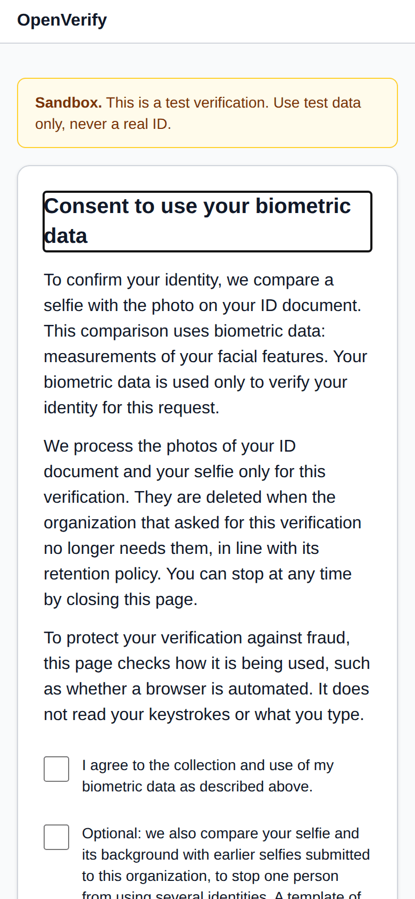
  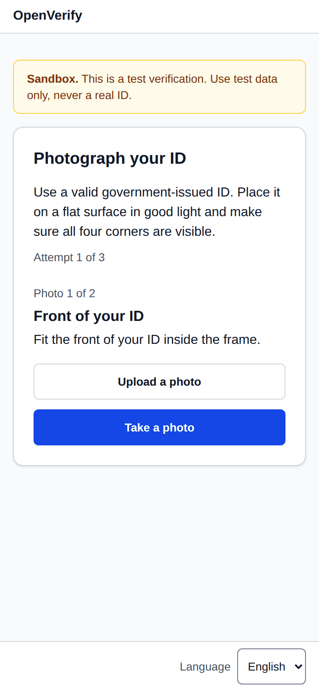
  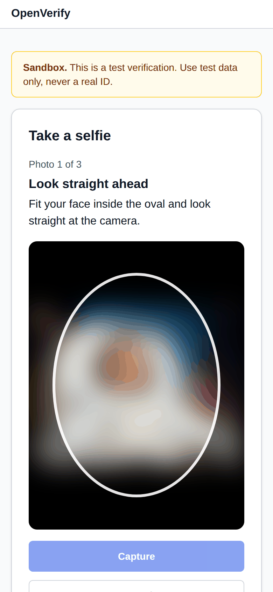
  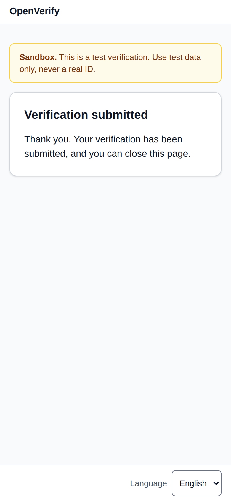
</p>

**The operator console**

<table>
<tr>
<td width="50%">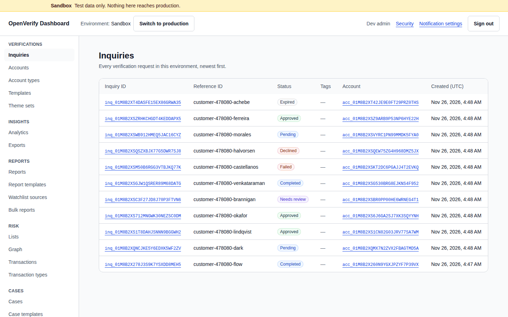<br><sub>Inquiries in every status</sub></td>
<td width="50%">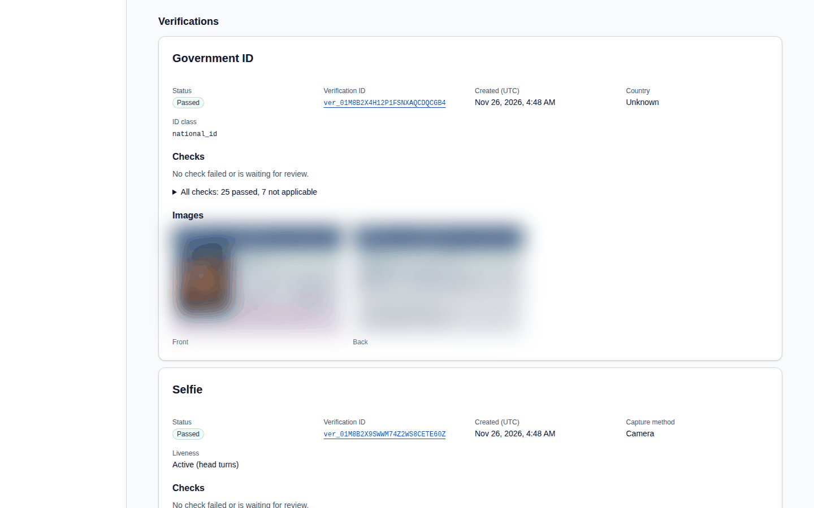<br><sub>An inquiry's verifications and checks</sub></td>
</tr>
<tr>
<td width="50%">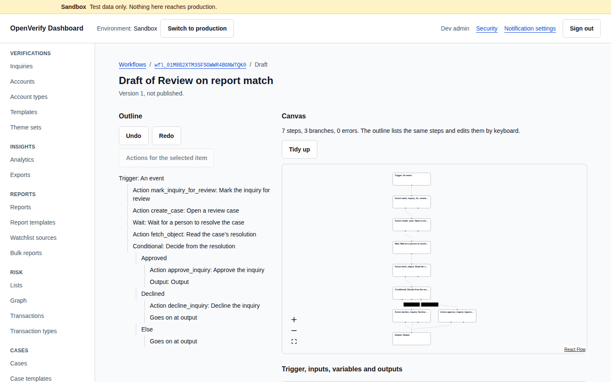<br><sub>The workflow editor</sub></td>
<td width="50%">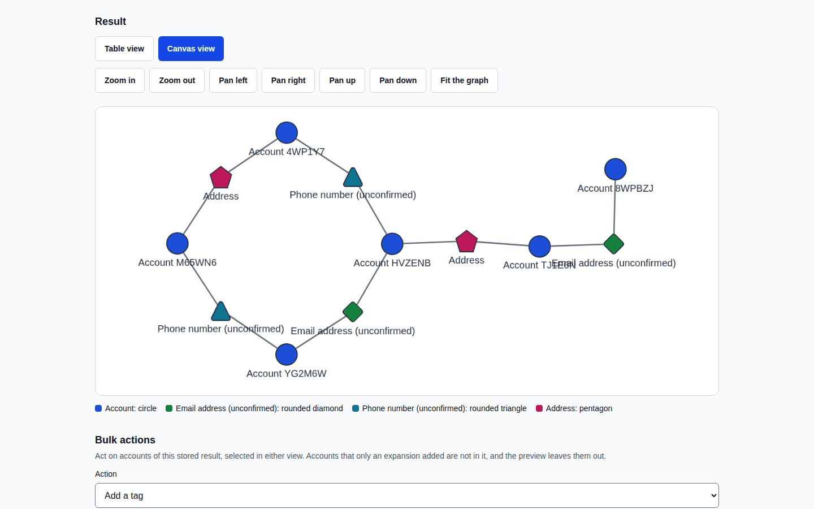<br><sub>The graph explorer</sub></td>
</tr>
</table>

<details>
<summary>More: cases, the flow builder, dark mode and the Android SDK</summary>

<p align="center">
  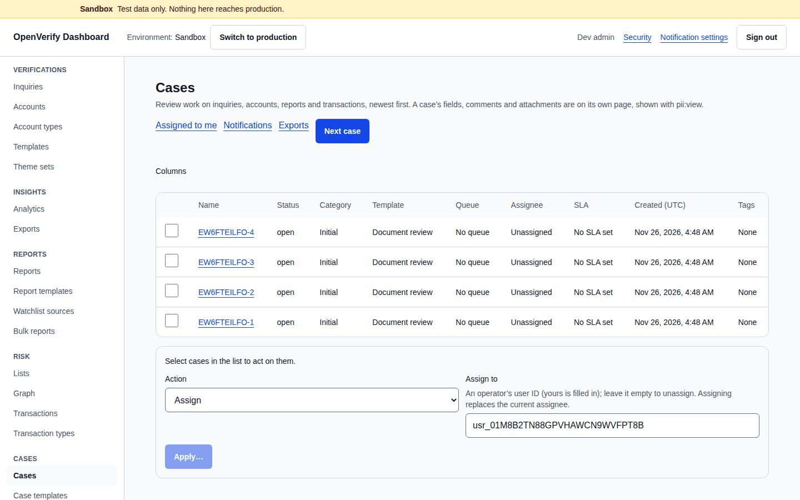
  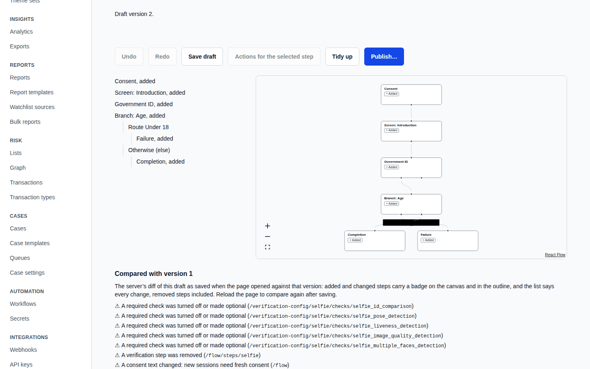
</p>
<p align="center">
  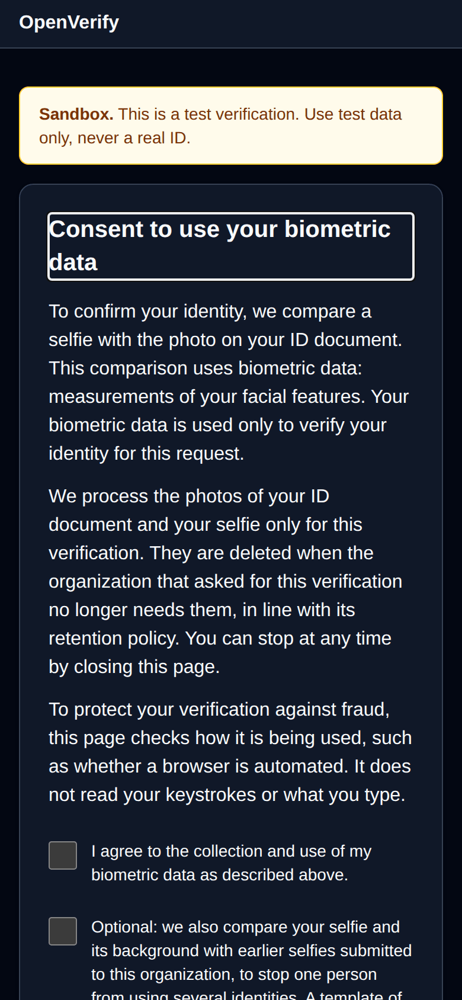
  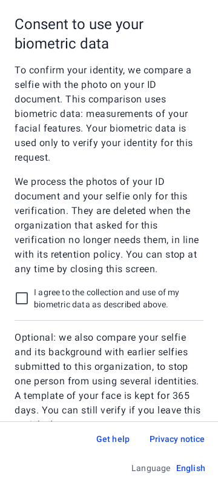
  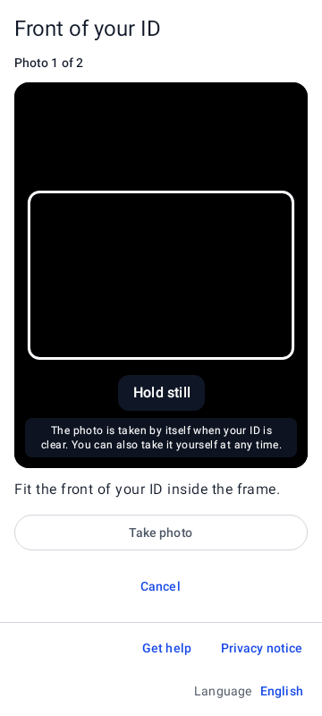
  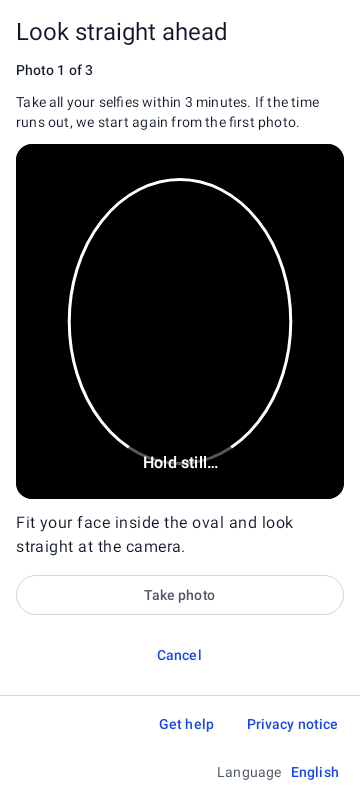
</p>

</details>

<sub>All screenshots come from the end-to-end stack's synthetic data; photos of faces are blurred.</sub>

## Features

<table>
<tr>
<td width="50%" valign="top">

**Government ID**
- 35 checks over the front and back of a card or passport: blur, glare, portrait, tamper and fabrication heuristics, expiry, age, repeat and inconsistency detection
- MRZ reading with check digits, PDF417 (AAMVA) barcodes, OCR field extraction with per-field sources
- Calibrated thresholds, each with its calibration report

**Selfie and liveness**
- Active liveness with guided poses, face match against the ID portrait, multiple-face, face-covering and image-quality checks
- On-device capture guidance in the web flow and the Android SDK; the server judges every upload

**NFC chip** (optional module)
- Reads ICAO 9303 passports and ID cards on Android; the server runs Passive and Active Authentication against trust anchors you install

**More verifications**
- Phone and email one-time codes, documents and proof of address, database lookups, AAMVA, crypto wallets, businesses (KYB) and their websites

</td>
<td width="50%" valign="top">

**Screening and reports**
- 11 report types: sanctions watchlists (OFAC, EU, UK, UN), politically exposed persons from Wikidata, adverse media, business, crypto address, email, phone, address, IP address and your own lists
- 19 signals: device, network and behaviour, with honest collection tiers

**Decisions and operations**
- Templates and a server-driven flow with branching, embedding and preview
- Visual workflows with sandboxed code steps, cases with SLAs and assignment, a relationship graph, transactions, analytics and exports
- Connect: share a completed verification with another organisation, with consent

**Platform**
- Organisations, sandbox and production environments, role-based access, OIDC single sign-on, TOTP multi-factor sign-in
- Scoped API keys, signed and replayable webhooks, an audit trail, retention and data-subject export
- PII encrypted at rest with key rotation; five languages in the flow, right-to-left included
- Docker Compose and a Helm chart; read-only, non-root images

</td>
</tr>
</table>

The full list, with each check's inputs, defaults, maturity and what it does **not** detect, is the [check catalog](docs/checks/catalog.md) (89 checks, 11 report types, 19 signals).

## How it works

<picture>
  <source media="(prefers-color-scheme: dark)" srcset="docs/assets/verification-journey-dark.svg">
  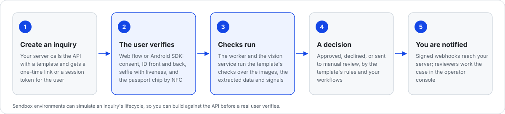
</picture>

## Architecture

<picture>
  <source media="(prefers-color-scheme: dark)" srcset="docs/assets/architecture-dark.svg">
  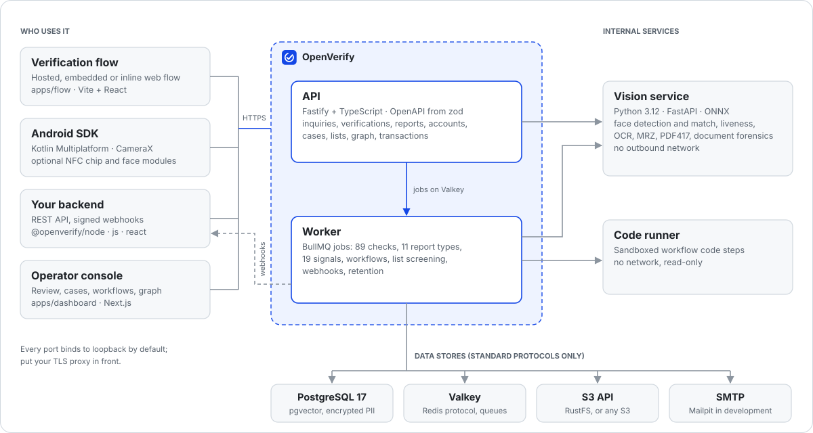
</picture>

| Component | Path | Stack |
|---|---|---|
| API and worker | [`apps/api`](apps/api) | Fastify, TypeScript, BullMQ, Drizzle; OpenAPI generated from zod schemas; RFC 9457 errors |
| Verification flow | [`apps/flow`](apps/flow) | Vite and React; hosted, embedded or inline |
| Operator console | [`apps/dashboard`](apps/dashboard/README.md) | Next.js |
| Vision service | [`services/vision`](services/vision/README.md) | Python 3.12, FastAPI, ONNX Runtime, OpenCV |
| Android SDK | [`android/`](android/openverify-sdk/README.md) | Kotlin Multiplatform, Compose Multiplatform, CameraX; optional [NFC](android/openverify-nfc/README.md) and [face](android/openverify-face/README.md) modules and a [demo app](android/demo-app/README.md) |
| Web SDKs | [`packages/node`](packages/node/README.md), [`packages/sdk-js`](packages/sdk-js/README.md), [`packages/sdk-react`](packages/sdk-react/README.md) | the server client with webhook verification, the embed client, React bindings |
| Domain packages | [`packages/`](packages) | `core` (domain, state machines, check registry), `checks` (pure check logic), `db`, `flow-spec`, `workflow-engine`, `watchlist`, `signals`, `emrtd`, `ui` |
| Deployment | [`infra/`](infra), [`deploy/helm`](deploy/helm/openverify) | Docker Compose, production Dockerfiles, Helm chart |

The data stores are reached only through standard protocols: PostgreSQL 17 with pgvector, the Redis protocol (Valkey), the S3 API (RustFS in development) and SMTP. Design decisions are recorded as [ADRs](docs/adr).

## Quick start

Run the whole stack on one machine with Docker Compose. You need Docker, Node.js 22.18 or later with pnpm 12, Python 3 and [uv](https://docs.astral.sh/uv/).

```bash
git clone https://github.com/hnalpha323/openverify.git && cd openverify
pnpm install --frozen-lockfile
cp .env.example .env                      # then replace every change-me-* value
python3 scripts/fetch_models.py && python3 scripts/fetch_data.py   # pinned, SHA-256-checked downloads
pnpm --filter @openverify/watchlist build:variant-groups
docker compose -f infra/docker-compose.yml --env-file .env --profile app up -d --wait --build

# a development organisation, operators for every role, a default template; prints an API key once
docker compose -f infra/docker-compose.yml --env-file .env --profile app run --rm migrate node dist/commands/seed-dev.js
```

Then open the console at <http://localhost:3001> and the API at <http://localhost:3000> (every port binds to `127.0.0.1` by default). For a real deployment, follow the [self-hosting guide](docs/self-hosting/README.md): [Docker Compose](docs/self-hosting/install-compose.md) or [Kubernetes with Helm](docs/self-hosting/install-kubernetes.md), production mode, secrets and rotation, backups, upgrades and monitoring.

### Create your first inquiry

```ts
import { createClient } from '@openverify/node';

const client = createClient({
  apiKey: process.env.OPENVERIFY_API_KEY!, // ov_sbx_... from seed-dev
  baseUrl: 'http://localhost:3000',
});

const { data: inquiry } = await client.inquiries.create({
  'inquiry-template-id': 'itmpl_...', // the default "Government ID and selfie" template
  'reference-id': 'customer-1234',
});
const { meta } = await client.inquiries.resume(inquiry.id);
console.log(meta['flow-url']); // send the person here, or launch the Android SDK with the session token
```

Then embed the flow with [`@openverify/react`](packages/sdk-react/README.md) or [`@openverify/js`](packages/sdk-js/README.md), launch it on Android with [`OpenVerifyInquiry.Contract()`](docs/android/integration.md), and [verify webhook signatures](packages/node/README.md#webhook-signatures) on your server. The packages are not on a registry yet; each README says how to build them from source.

## Project status

OpenVerify is **pre-alpha**: built and tested end to end, but not yet released and not yet proven in production.

- **No release has been published.** No image, chart or package is on a registry yet, and nothing is signed. Build from source.
- **Honest checks.** Every heuristic or model-based check ships as `beta` with a confidence score, and each check's page says what it does not detect. Checks that need licensed data ship as adapters with a deterministic sandbox provider. No check ever fakes a pass. See [ADR 0002](docs/adr/0002-check-tiers.md) and the [calibration reports](docs/calibration).
- **Self-assessed security.** The [threat model](docs/security/threat-model.md) and the OWASP ASVS and MASVS checklists are the project's own assessment. They are not a certification, and installing OpenVerify does not on its own make a deployment meet any law. The [compliance guide](docs/compliance/README.md) and the built-in consent texts are not reviewed by counsel yet.
- **Device testing.** The Android SDK is tested on the host and on one physical phone; the NFC reader has not read a real document yet.

The release checklist and its open items are in [`docs/release/`](docs/release/checklist.md).

## Documentation

| Topic | Where |
|---|---|
| Self-hosting: install, configuration, sizing, backups, upgrades, SSO, monitoring | [`docs/self-hosting/`](docs/self-hosting/README.md) |
| REST API reference and conventions | [`docs/api/`](docs/api/README.md) |
| Checks: catalog, families, calibration | [`docs/checks/catalog.md`](docs/checks/catalog.md), [`docs/calibration/`](docs/calibration) |
| Flows, templates, themes and languages | [`docs/flows/`](docs/flows/README.md), [`docs/flow/`](docs/flow/README.md), [`docs/themes/`](docs/themes/README.md), [`docs/i18n/`](docs/i18n/README.md) |
| Workflows, cases, lists, graph, transactions, reports | [`docs/workflows/`](docs/workflows/README.md), [`docs/cases/`](docs/cases/README.md), [`docs/lists/`](docs/lists/README.md), [`docs/graph/`](docs/graph/README.md), [`docs/transactions/`](docs/transactions/README.md), [`docs/reports/`](docs/reports/README.md) |
| Android integration guide | [`docs/android/`](docs/android/README.md) |
| Sharing verifications (Connect) | [`docs/connect/`](docs/connect/README.md) |
| Security: threat model, policies, checklists | [`docs/security/`](docs/security/README.md) |
| Compliance guide for operators | [`docs/compliance/`](docs/compliance/README.md) |
| Architecture decision records | [`docs/adr/`](docs/adr) |
| The plan and the build log | [`docs/PLAN.md`](docs/PLAN.md), [`docs/PROGRESS.md`](docs/PROGRESS.md), test-first evidence in [`docs/tdd/`](docs/tdd) |

## Contributing

Contributions are welcome: bug reports, documentation, translations, checks and calibration data. Read [CONTRIBUTING.md](CONTRIBUTING.md) for the development setup, the test-first rule and the review process, and follow the [Code of Conduct](CODE_OF_CONDUCT.md). Questions go to [GitHub Discussions](https://github.com/hnalpha323/openverify/discussions); see [SUPPORT.md](SUPPORT.md).

Please report security issues privately, as [SECURITY.md](SECURITY.md) describes, never in a public issue.

## License

OpenVerify is licensed under the [Apache License 2.0](LICENSE).

The optional Android NFC module (`android/openverify-nfc`) is a separate artifact under LGPL-3.0, because it depends on JMRTD and cert-cvc (`LGPL-2.1-or-later`) and SCUBA (`LGPL-2.1-or-later AND GPL-2.0-only WITH Classpath-exception-2.0`). Third-party components, models and data, with their licences, are listed in [THIRD_PARTY_LICENSES.md](THIRD_PARTY_LICENSES.md).

## Acknowledgements

OpenVerify builds on open models and public data: IP geolocation by [DB-IP](https://db-ip.com) (CC BY 4.0); politically exposed persons derived from [Wikidata](https://www.wikidata.org) (CC0); sanctions lists published by the US Treasury (OFAC), the European Commission, the UK government and the UN Security Council; and the open-source projects listed in [THIRD_PARTY_LICENSES.md](THIRD_PARTY_LICENSES.md).
