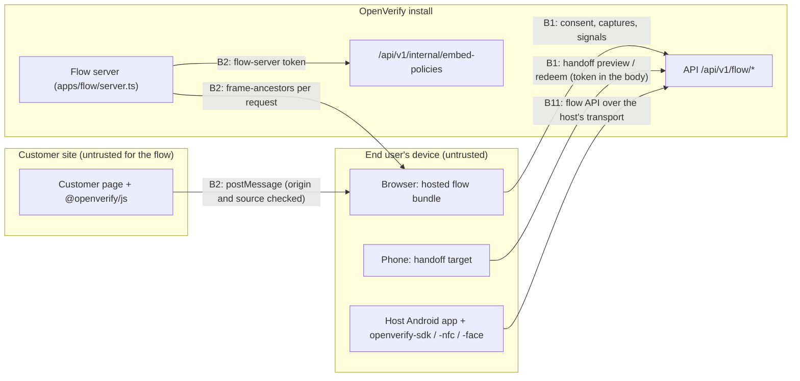
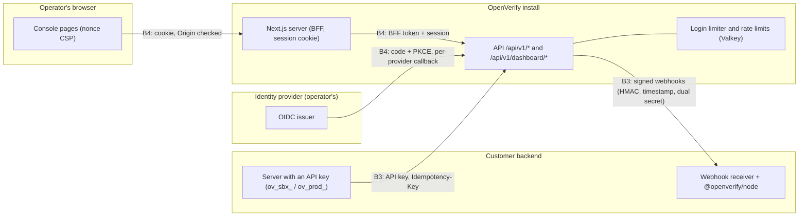
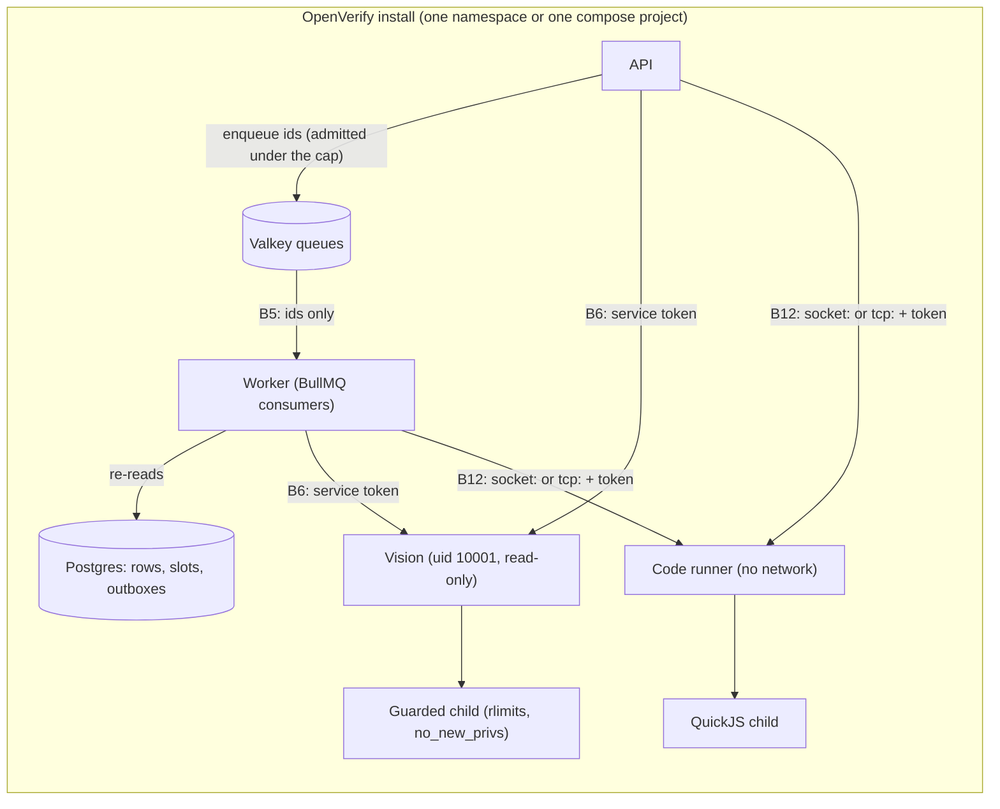
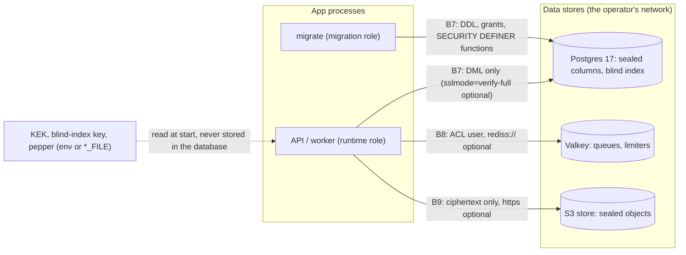
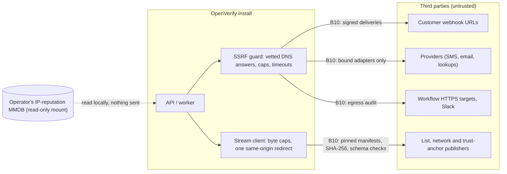
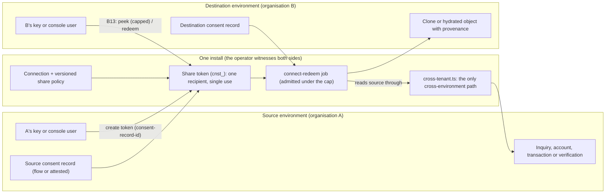
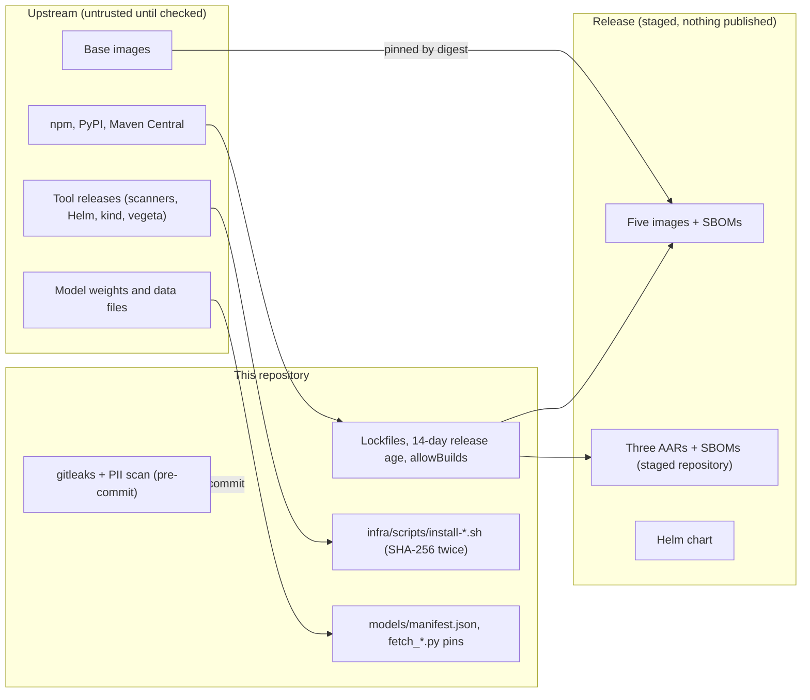

# Threat model

OpenVerify's own threat model, self-assessed and never certified (ADR 0010). It is the project's
first pass over the code as built at the end of Phase 11's Workflow 11D: it names what we found,
not everything an attacker could find (C273.6). STRIDE is applied per trust boundary, and every
threat has an id that the ASVS and MASVS checklists (`asvs-5.0.0-l2.csv`, `masvs-2.1.0.csv`), the
tests and the findings cite.

- **Written:** 2026-11-20 by Workflow 11E (`docs-security`), against the tree at `2952f2a84`
  (11E's Stage 1a end; base `aa00b57bb`, the 11D close).
- **Reviewed:** 2026-11-20, against `7d813b436`, beside the ASVS and MASVS checklists (Workflow 11E's review,
  checkpoint 3 of `docs-security`); integration-11e records it with its commit for PROGRESS.
- **Upkeep (C273.5):** a full review at each phase end beside the ASVS review, recorded with its
  commit in `docs/PROGRESS.md`; every phase plan lists the rows it adds or changes. A new input or
  route family, data store, outbound integration, secret, privilege or client is a trigger for a
  review.
- **The test:** `packages/docs-tools/src/security/threat-model.test.ts` (C273.4) parses this file:
  every boundary considers all six STRIDE letters, as a row or as a line
  `- <boundary> <letter>: not applicable because <reason>`; every status is one of the four below;
  every `control` cites a repository path that exists, and every cited path exists; every `gap`
  names a phase, a Workflow, the next release or a finding id; ids are unique; every `accepted` row
  is in [Accepted risks](#accepted-risks) with its monitoring. The API suite's
  `apps/api/src/metrics-documents.test.ts` checks that every metric named here (`metric: <name>`)
  is registered in `apps/api/src/metrics-registry.ts` (C250.7).

**Statuses (C273.1):** `control` (exists, with its evidence paths), `gap` (open, with the phase,
release or finding that owns it), `accepted` (a documented residual risk), `operator` (only the
deployment can meet it; the self-hosting guide carries each one). **Evidence** names source files
and the tests that hold them; no row rests on a CI run (no CI run has executed a step since the 10C
push, rule 25), and a device behaviour cites its recorded run on the owner's phone. **"Ours"**
marks a behaviour the platform OpenVerify is modelled on does not have, with its reason.

## Boundaries

| boundary | what crosses it |
|---|---|
| B1 | The hosted flow: the end user's browser, `apps/flow` and its server, and `/api/v1/flow/*` (consent, captures, signals, handoff) |
| B2 | The embedded flow and the console's preview: a customer page, the flow iframe, `@openverify/js` (`postMessage`), the flow server's per-request headers and the internal embed-policy route |
| B3 | The public API: a customer backend with an API key on `/api/v1/*`, and webhooks back to it |
| B4 | The console: the operator's browser, the Next.js server (BFF) and `/api/v1/dashboard/*`, with passwords, MFA, OIDC and sessions |
| B5 | Workers: BullMQ consumers on Valkey and the per-environment admission caps |
| B6 | Vision: the API and worker calling `services/vision` and its guarded child |
| B7 | Postgres: the runtime and migration roles, sealed columns, the blind index |
| B8 | Valkey: queues, the rate limiters, the login limiter, caches |
| B9 | The S3 store: sealed objects (captures, files, exports, snapshots) |
| B10 | Outbound fetches: webhooks, providers, list and network syncs, trust anchors, the workflow HTTPS action, email, SMS and Slack |
| B11 | The Android SDK: the host app, `openverify-sdk`, `openverify-nfc`, `openverify-face` and `/api/v1/flow/*` |
| B12 | The code runner: Evaluate Code's QuickJS child, reached over `socket:` or `tcp:` |
| B13 | Connect: sharing between two organisations' environments on one install (ADR 0010) |
| B14 | The supply chain: dependencies, actions, base images, tools, models, data downloads and the release |
| BX | Across every boundary: operator-supplied patterns and other cross-cutting threats |

## End-user clients (B1, B2, B11)

| id | boundary | STRIDE | threat | status | evidence | mitigation or owner |
|---|---|---|---|---|---|---|
| B1-S1 | B1 | S | A forwarded or intercepted flow link lets someone else complete the inquiry first; QR handoff phishing ("illicit onboarding", RFC 10027 example B6) gets a victim to verify an attacker's account | accepted | `docs/flow/handoff.md`, `apps/flow/src/handoff/handoff-client.ts`, `apps/api/src/services/handoff/flow-handoffs.test.ts` | Credentials ride in the URL fragment and are cleared from the address bar; links are single use and expire; the phone records its own consent and sees a context screen with Decline; "this was not me" cancels the phone's captures. A link used before its owner is not detectable by the flow, and a live coached relay is not prevented: the residual risk the handoff note states |
| B1-S2 | B1 | S, I | A handoff token stolen from the QR, a link or a mailbox, or a six-digit confirmation code guessed | control | `apps/api/src/services/handoff/flow-handoffs.ts`, `apps/api/src/services/handoff/flow-handoffs.test.ts`, `apps/api/src/services/handoff/handoff-races.integration.test.ts`, `apps/api/src/routes/handoff-routes.test.ts`, `docs/flow/handoff.md` | `ovh_` plus 32 random bytes, only its SHA-256 stored and compared in constant time, bound to the inquiry, step and issuing session, single use, and a new token revokes the last; the code is stored as SHA-256 over token and code and the fifth wrong code revokes the token; one uniform 410 for every failure; `flow-handoffs` 5 an hour per session, `flow-handoffs-ip` 10 an hour per address, and the redemption routes under `one-time-link-redeem` per address |
| B1-S3 | B1 | S | A handoff redemption used to take over the desktop's session, or a link scanner burning the token | control | `apps/api/src/services/handoff/flow-session.ts`, `apps/api/src/routes/handoff-routes.test.ts`, `apps/flow/src/handoff/handoff-redeem-flow.test.tsx` | Redemption opens a session of the phone's own (the desktop's credential never travels); the preview uses nothing up, so a mail sandbox opening the link does no harm; the template's `max-sessions` cap applies after the token check |
| B1-S4 | B1 | S | A residential proxy, a VPN or a mobile range hides where a session comes from | accepted | `docs/network/README.md`, `packages/core/src/signal-registry.ts` | The network facts see listed ranges only: a hosting-ASN hit is ours and heuristic, a `low` threat level means no listed risk found (`vpn_list_not_exhaustive`), and the proxy flag needs an operator's adapter (`proxy_not_evaluated`); signals are review facts, never a verdict |
| B1-T1 | B1 | T | Injected camera streams, replayed or synthetic images, deepfakes | accepted | `docs/checks/selfie.md`, `packages/core/src/check-registry.ts` | Server-side analysis only, a randomised pose challenge with a server nonce, liveness labelled beta with its evidence (PLAN §9). Presentation attacks remain possible; no presentation-attack certification is claimed |
| B1-T2 | B1 | T | The client chooses the address it is judged by through `X-Forwarded-For` | control | `apps/api/src/network/private-peers.ts`, `apps/api/src/network/private-peers.test.ts`, `apps/api/src/operator-auth/trust-proxy.test.ts`, `docs/network/README.md` | Every network fact describes `request.ip` under `OPENVERIFY_TRUST_PROXY`; `true` (trust-all) makes every production fact null with `client_address_untrusted`; a hop count warns at start; the trust mode is recorded on every network row. Choosing the proxy list is the operator's (B1-D2) |
| B1-I1 | B1 | I | XSS on the flow origin reads the session token and the captures | control | `apps/flow/src/security/security-meta.ts`, `apps/flow/src/security/security-meta.test.ts`, `apps/flow/src/security/response-headers.ts`, `apps/flow/src/server/server-headers.test.ts`, `infra/tests/flow-headers.test.sh` | A build-time `<meta>` CSP (`script-src 'self' 'wasm-unsafe-eval'`, `object-src 'none'`, `base-uri 'none'`, `form-action 'none'`) plus the flow server's response headers; operator copy and themes are data, rendered escaped; no third-party script |
| B1-I2 | B1 | I | The flow framed by a hostile page (clickjacking, overlay) | control | `apps/flow/server.ts`, `apps/flow/src/server/server-headers.test.ts`, `infra/tests/flow-headers.test.sh` | The flow server sends `frame-ancestors` per request from the template's allowed origins and fails closed (G-FRAME, Phase 9 C157) |
| B1-I3 | B1 | I | Signals collected before consent, or beyond what the consent text names | control | `apps/api/src/routes/flow/signals.ts`, `apps/api/src/routes/flow/signals.test.ts`, `apps/flow/src/flow/use-signal-collection.ts`, `packages/signals/src/browser/collector.test.ts` | The collector starts only after consent; `POST /api/v1/flow/signals` answers 409 `consent_required` before it, and caps a body at 8,192 B and a session at 200 bodies; every browser API read has a registry entry and a text key (C94) |
| B1-I4 | B1 | I | The collector breaks the flow's CSP, or a client address, fingerprint or user agent reaches a log | control | `apps/flow/src/flow/flow-renderer-signals.test.tsx`, `apps/flow/e2e/signals.spec.ts`, `apps/api/src/logger.ts`, `apps/api/src/logger.test.ts` | The collector uses no network but its one POST, no storage and no worker, within a 4,096 B gzipped budget; the request log is `{method, route}`; addresses, coordinates, fingerprints and user agents appear only under the `pii` log key (C53.8, C93.7) |
| B1-I5 | B1 | I | A forwarded flow link reveals a copy a destination hydrated or cloned through Connect | control | `apps/api/src/services/connect/client-side.ts`, `apps/api/src/services/connect/client-side.test.ts` | The flow never renders a hydrated or cloned value to the person (C235.8), so whoever opens a forwarded link learns nothing from the copy |
| B1-D1 | B1 | D | Upload floods and oversized or decompressing files | control | `apps/api/src/plugins/rate-limit.ts`, `apps/api/src/plugins/rate-limit.test.ts`, `services/vision/tests/test_limits.py` | Multipart limits, the `flow-session` and `flow-ip` policies, vision's pixel and page limits. The load test's upload row was not measured (`docs/calibration/load-phase11.md`: the knee was 5/s) |
| B1-D2 | B1 | D, S | A misconfigured proxy chain makes every session look like the proxy, or a hop count lets a direct client choose its address | operator | `docs/network/README.md`, `docs/self-hosting/hardening-checklist.md` | The operator sets `OPENVERIFY_TRUST_PROXY` to the proxies' addresses (a list, preferred); the API warns on a hop count and on production sessions from private peers |
| B1-R1 | B1 | R | An end user later denies consenting to biometric processing | control | `apps/api/src/routes/flow/consent-phase4.test.ts`, `apps/api/src/services/templates/consent-texts.android.test.ts`, `docs/compliance/session-integrity.md` | The consent step comes first; the record holds the time, the text keys and their digests, the locale, and the sealed address and user agent (Phase 9 C162.9). It shows what the server served and that the client reported showing it, not who held the device |
| B1-E1 | B1 | E | A flow session reaches another inquiry, or a flow action runs outside the server's position | control | `apps/api/src/auth/flow-session.ts`, `apps/api/src/flow-engine/handoff-skip.android.integration.test.ts`, `docs/flows/engine.md` | A flow session is bound to one inquiry; the server decides the position and refuses an exit that is not the current step's (`flow_step_not_current`), the share-consent withdrawal being the one listed exception (C237.6) |
| B2-S1 | B2 | S | A hostile page embeds the flow or spoofs messages to the iframe or to the SDK | control | `packages/sdk-js/src/embed.ts`, `packages/sdk-js/src/embed.test.ts`, `apps/flow/src/embed/bridge.ts`, `packages/contracts/src/origin-pattern.ts`, `apps/api/src/routes/internal/embed-policies.ts` | `frame-ancestors` from the template's allowed origins per request (`localhost` only in sandbox); both sides check `event.origin` and `event.source`; operator origin patterns are parsed by a constant grammar, never compiled |
| B2-S2 | B2 | S | The console's credential-free preview frame is driven by another origin | control | `apps/dashboard/src/components/flow-preview/preview-protocol.ts`, `apps/dashboard/src/components/flow-preview/preview-protocol.test.ts`, `apps/flow/src/preview/protocol.ts`, `docs/flows/preview-and-simulate.md` | The preview holds no credential; messages are taken only from the expected origin and window (ADR 0008) |
| B2-T1 | B2 | T | The parent page changes prefill or reference data in the iframe | control | `packages/sdk-js/src/frame-url.ts`, `packages/sdk-js/src/frame-url.test.ts`, `docs/flows/embedding.md` | Inquiries are created server-side with an API key; the flow reads the inquiry from the API and never takes identity fields from the parent page |
| B2-I1 | B2 | I | Events posted with target `*` leak inquiry ids and statuses to other frames | control | `packages/sdk-js/src/messages.ts`, `packages/sdk-js/src/messages.test.ts`, `packages/contracts/src/flow-messages.ts` | An exact target origin per message; messages carry no PII (C159) |
| B2-E1 | B2 | E, S | The internal embed-policy route answers a caller other than the flow server | control | `apps/api/src/routes/internal/embed-policies.ts`, `apps/api/src/routes/internal/embed-policies.test.ts`, `apps/api/src/http/internal-listener.ts`, `apps/api/src/http/internal-listener.test.ts` | The flow-server token (with its `_PREVIOUS`) guards it under rate policy `internal-embed-policy`; with `OPENVERIFY_INTERNAL_LISTEN` set the internal routes answer only on the second listener and the public one answers the generic 404; unset in production logs `internal_listen_unset`. The chart sets it and denies the path at the ingress |
| B2-D1 | B2 | D | The flow server's policy lookup floods the API | control | `apps/flow/src/server/server-lookup.test.ts`, `packages/contracts/src/rate-limits.ts` | The lookup is limited by `internal-embed-policy` and fails closed: no allowed origin, no frame |
| B11-T1 | B11 | T | Rooted, emulated or hooked devices, virtual cameras, a modified host app | accepted | `android/openverify-sdk/src/androidHostTest/kotlin/dev/openverify/sdk/signals/IntegrityProbesTest.kt`, `apps/api/src/services/device-integrity/`, `docs/android/device-integrity.md` | The server never trusts the device: the emulator, root and hooking indicators are beta signals never decisive alone; the `deviceIntegrity` provider (play-integrity or sandbox) decodes a token server-side. Phase 10 P3 is declined, so no Play Integrity library ships; the host supplies an `IntegrityTokenProvider` |
| B11-T2 | B11 | T | The device decides a transition or a result | control | `android/openverify-sdk/src/androidHostTest/kotlin/dev/openverify/sdk/flow/FlowCoordinatorHandoffTest.kt`, `docs/android/integration.md` | The SDK renders the server's position for flow-spec 2 and evaluates no transition on the device (ADR 0009) |
| B11-T3 | B11 | T, S | A cloned or altered document chip, or the sandbox test chip passed off in production | control | `packages/emrtd/src/passive-authentication.ts`, `packages/emrtd/src/passive-authentication.test.ts`, `packages/checks/src/nfc/id-nfc-passive-authentication-detection.test.ts`, `apps/api/src/trust-anchors/sandbox.ts`, `apps/api/src/trust-anchors/sandbox.test.ts` | Passive authentication runs on the server against trust anchors synced from pinned manifests (`trust-anchors:sync`); the Utopia test anchor is `sandbox_only`, so the production loader never returns it, and `trust:sandbox-utopia` refuses production mode. A real-document chip read is the owner's release-gate step (KP10-58) |
| B11-I1 | B11 | I | Captures or personal data left in app storage, logcat, exceptions, screenshots or the recents view | control | `android/openverify-sdk/src/androidHostTest/kotlin/dev/openverify/sdk/privacy/LogScanTest.kt`, `android/openverify-sdk/src/androidHostTest/kotlin/dev/openverify/sdk/privacy/DataAtRestScanTest.kt`, `android/openverify-sdk/src/androidHostTest/kotlin/dev/openverify/sdk/privacy/SavedStateCanaryTest.kt`, `android/openverify-sdk/src/androidHostTest/kotlin/dev/openverify/sdk/privacy/WindowSecureFlagTest.kt`, `android/openverify-sdk/src/androidHostTest/kotlin/dev/openverify/sdk/privacy/WindowSitesScanTest.kt`, `android/openverify-sdk/src/androidHostTest/kotlin/dev/openverify/sdk/api/FlowApiExceptionCanaryTest.kt` | Source scans over every module of `SdkModule.ALL`, the saved-state and exception canaries, `FLAG_SECURE` on every SDK window (10C); the four device suites ran 22 of 22 on a Pixel 9 (Android 17) at `d6af3cc37`, twice at the 11A close and once at the 11C close (`docs/PROGRESS.md`) |
| B11-I2 | B11 | I | Overlays or tapjacking over the capture and consent screens | control | `android/openverify-sdk/src/commonMain/kotlin/dev/openverify/sdk/ui/screen/Protections.kt`, `android/openverify-sdk/src/androidHostTest/kotlin/dev/openverify/sdk/privacy/ProtectionScanTest.kt` | Every SDK screen is drawn through the protections, and a scan fails a screen without them |
| B11-I3 | B11 | I | The optional modules leak data: JMRTD's or SCUBA's loggers in `openverify-nfc`, ONNX Runtime telemetry in `openverify-face` | control | `android/openverify-nfc/src/main/kotlin/dev/openverify/nfc/LibraryLoggers.kt`, `android/openverify-nfc/src/test/kotlin/dev/openverify/nfc/LibraryLoggersTest.kt`, `android/openverify-face/src/test/kotlin/dev/openverify/face/OrtTelemetryClassesTest.kt`, `android/openverify-face/src/androidTest/kotlin/dev/openverify/face/OrtTelemetryDeviceTest.kt` | The library loggers are silenced; ORT telemetry classes are held absent on the host and on the device (Phase 10 P1 and P2, granted narrowly: `THIRD_PARTY_LICENSES.md` section 6) |
| B11-S1 | B11 | S | A man-in-the-middle with a user-installed or mis-issued CA, or plain http to a remote host | control | `android/openverify-sdk/src/commonMain/kotlin/dev/openverify/sdk/api/LoopbackPolicy.kt`, `android/openverify-sdk/src/androidHostTest/kotlin/dev/openverify/sdk/api/LoopbackPolicyTest.kt`, `android/openverify-sdk/src/androidHostTest/kotlin/dev/openverify/sdk/CertificatePinningRecipeTest.kt`, `android/openverify-sdk/src/androidHostTest/kotlin/dev/openverify/sdk/privacy/NetworkTrustScanTest.kt` | Plain http only to loopback in a debuggable build; the platform trust store; certificate pinning is a documented host recipe through the transport (C256.2), held by a host test and never built in, because each self-hoster has its own certificates |
| B11-R1 | B11 | R | A user later disputes what the SDK showed them | control | `android/openverify-sdk/src/commonMain/kotlin/dev/openverify/sdk/consent/ConsentDigests.kt`, `android/openverify-sdk/src/androidHostTest/kotlin/dev/openverify/sdk/api/ShareConsentRequestFixturesTest.kt` | The SDK echoes digests it recomputed over the text it displayed and renders the unsupported screen on a mismatch; the server stores them as client-reported (D4: no console view shows them yet) |
| B11-D1 | B11 | D | A chip read or face detection exhausts the device | control | `android/openverify-nfc/src/test/kotlin/dev/openverify/nfc/JmrtdChipSessionTest.kt`, `android/openverify-face/src/test/kotlin/dev/openverify/face/OrtFaceDetectorTest.kt` | Each chip exchange has a 5 s timeout (`EXCHANGE_TIMEOUT_MS`), and a read runs only while its step is shown; the detector runs on the frames the capture step hands it; the size configurations are measured (`docs/android/sizes.md`) |
| B11-E1 | B11 | E | The public API or a dependency change widens what a host reaches, or a Google library ships against Phase 10 P3 | control | `android/openverify-sdk/src/androidHostTest/kotlin/dev/openverify/sdk/AbiDumpTest.kt`, `android/openverify-sdk/src/androidHostTest/kotlin/dev/openverify/sdk/PublicSurfaceTest.kt`, `android/openverify-sdk/api/expected-public.txt`, `android/scripts/check-staged-repository.py`, `android/gradle/verification-metadata.xml` | The ABI dumps held by `checkKotlinAbi` for the three published modules; dependency locking and verification; the staged-repository check refuses a `com.google.android.play` dependency |

- B2 R: not applicable because the embedded flow records nothing of its own: consent, captures and audit entries cross B1 and B3, and the SDK's messages are notices, not records.

## Customers and operators (B3, B4)

| id | boundary | STRIDE | threat | status | evidence | mitigation or owner |
|---|---|---|---|---|---|---|
| B3-S1 | B3 | S | A stolen API key | control | `packages/db/src/api-keys.ts`, `packages/db/src/api-keys.test.ts`, `apps/api/src/auth/api-key-lookup.ts`, `apps/api/src/auth/api-key-lookup.test.ts`, `apps/api/src/services/api-keys/rotate.ts`, `docs/settings/api-keys.md` | 256 random bits stored as HMAC-SHA-256 under the pepper; recognisable `ov_sbx_` and `ov_prod_` prefixes; scopes, expiry, up to 50 allowed addresses, one-call rotation, age warnings and attribute blocklists (Phase 9) |
| B3-S2 | B3 | S | The pepper rotation window: keys still hashed under a previous pepper, or a leaked pepper | control | `apps/api/src/auth/api-key-pepper.integration.test.ts`, `packages/db/src/api-keys-pepper.test.ts`, `apps/api/src/operator-commands/api-keys-pepper-status.ts`, `apps/api/src/operator-commands/api-keys-pepper-status.test.ts` | `OPENVERIFY_API_KEY_PEPPER_PREVIOUS` (at most two); a key found under a previous pepper is re-hashed under the current one in the same request (compare-and-set); `api-keys:pepper-status` counts the keys left, never printing a key or a hash. A pepper protects a database-only leak; once the pepper itself leaks, every key must be re-issued (C247.4) |
| B3-S3 | B3 | S | A leaked production key goes unnoticed because scanners do not know its shape | operator | `docs/self-hosting/hardening-checklist.md`, `docs/settings/api-keys.md` | The operator registers the `ov_prod_` prefix as a custom secret pattern where their scanners allow it |
| B3-T1 | B3 | T | Replayed or duplicated writes; a forged webhook | control | `apps/api/src/plugins/idempotency.ts`, `apps/api/src/plugins/idempotency.test.ts`, `packages/node/src/webhook-signature.ts`, `packages/node/src/webhook-signature.test.ts`, `packages/node/src/webhook-signature.timing.test.ts`, `docs/settings/webhooks.md` | Idempotency keys on `POST` and `PATCH` (a repeat returns the first answer); webhooks signed with a timestamp and an HMAC, dual-signed while a rotated secret's previous value lives; `@openverify/node` verifies in constant time within 300 s by default; failing deliveries raise the webhook's failure alerts. A receiver that does not verify is the customer's risk |
| B3-T2 | B3 | T | CSV injection through exported values, imported list rows or the translation CSV | control | `packages/checks/src/csv/index.ts`, `packages/checks/src/csv/csv.test.ts`, `packages/checks/src/csv/read.ts`, `packages/checks/src/csv/read.test.ts`, `apps/api/src/services/importers/read-file.ts`, `apps/api/src/services/importers/read-file.test.ts`, `apps/api/src/services/templates/translations.ts` | One shared writer neutralises every cell that starts with OWASP's listed characters, with golden vectors; imports are decoded strictly and capped. OWASP warns that no escape is safe in every spreadsheet program, so a recipient's spreadsheet settings still matter |
| B3-T3 | B3 | T | Unscreened, unindexed or unevaluated data reads as clean | control | `apps/api/src/services/lists/match.test.ts`, `apps/api/src/services/graph/expand.test.ts`, `packages/core/src/signal-registry.ts`, `docs/checks/signals.md` | Null reasons from one frozen enum instead of `false`; `unscreened` and `not-applicable` on every exit; `index-complete` on graph results; signals that are never false where the data is not exhaustive (C90, C99, C101.5) |
| B3-T4 | B3 | T | A blind-index key change silently breaks lists, devices, transaction field keys and the graph | control | `apps/api/src/blind-index-rebuild.test.ts`, `apps/api/src/blind-index-rebuild.integration.test.ts`, `apps/api/src/services/lists/rebuild.ts`, `apps/api/src/services/lists/rebuild.test.ts` | `blind-index:rebuild` recomputes every key from sealed sources (devices, transaction field keys, the graph); an outdated list item answers `normaliser_outdated` until it is re-keyed |
| B3-T5 | B3 | T | A hostile case attachment reaches a reviewer (a mislabelled type, malware, an exploit for the viewer) | control | `apps/api/src/services/cases/attachments/store.ts`, `apps/api/src/services/cases/attachments/attachments.test.ts`, `apps/api/src/services/cases/attachments/file-renditions.test.ts`, `packages/contracts/src/case-attachments.test.ts`, `docs/cases/attachments.md` | Typed by its magic bytes (JPEG, PNG, WebP, PDF), never the client's word, at most 10 MiB; scanned by the bound `attachmentScanner` (sandbox, or `clamd` at `OPENVERIFY_CLAMD_SOCKET`), where only `OK` reads clean; reviewers see metadata-free renditions from vision, never the original; case exports are CSV-neutralised and masked, and printing is audited |
| B3-T6 | B3 | T | No malware scanner runs, so every attachment reads `error`, or the scanner's signatures go stale | operator | `apps/api/src/providers/attachment-scanner/clamd.ts`, `docs/cases/attachments.md` | No ClamAV image ships (ClamAV is GPL-2.0): the operator runs `clamd` beside the worker (the chart's `worker.extraContainers` with a shared socket) and keeps its signatures current |
| B3-R1 | B3 | R | A customer denies an API action | control | `apps/api/src/plugins/api-logs.ts`, `apps/api/src/plugins/api-logs.test.ts`, `apps/api/src/services/audit-log.ts`, `apps/api/src/services/audit-log.test.ts` | API logs with request ids (30 days by default), events and audit entries naming the key or user |
| B3-R2 | B3 | R | Logs and audit entries kept only on the install can be lost or rewritten with it | operator | `docs/security/logging.md`, `docs/self-hosting/monitoring.md` | The operator ships logs and audit entries to a separate store (G-LOGINV, ASVS v5.0.0-16.4.3); the platform writes JSON lines to stdout |
| B3-R3 | B3 | R | The runtime role deletes audit evidence | control | `packages/db/src/delete-guard.integration.test.ts`, `packages/db/src/runtime-role.integration.test.ts`, `packages/db/drizzle/0036_phase11_hardening.sql`, `apps/api/src/services/access/audit-retention.ts` | `audit_logs` grants the runtime `SELECT, INSERT` only, a trigger refuses `UPDATE` and a `BEFORE DELETE` trigger refuses every delete but the migration role's and the environment cascade; retention runs through `openverify_delete_expired_audit_logs`, never below its 30-day floor. The floor is measured from the time the caller states, so a runtime stating a false time could reach entries younger than 30 days (KP11-45; B3-R4) |
| B3-R4 | B3 | R | A compromised runtime calls the audit retention function with a future time and removes recent entries | accepted | `packages/db/drizzle/0036_phase11_hardening.sql`, `packages/db/src/delete-guard.integration.test.ts` | It can never delete an entry directly, and the function deletes only entries older than the environment's setting from the stated time; entries shipped off the install (B3-R2) are out of its reach |
| B3-I1 | B3 | I | Object-level authorisation failure across environments or organisations (BOLA) | control | `apps/api/src/security/cross-tenant-probe.integration.test.ts`, `apps/api/src/services/connect/authorization-matrix.test.ts` | Repositories scoped by environment; one generic 404 for every object the caller may not see; the generated probe calls organisation B's key on A's ids and expects the identical 404 (22 families, 115 of 257 server operations at the 11B close) |
| B3-I2 | B3 | I | The cross-tenant probe does not reach every id family, the dashboard operations or the flow operations | gap | `apps/api/src/security/cross-tenant-probe.integration.test.ts` | KP11-10, Workflow 11F: the other 49 id families, the `name:key`, `name:fieldKey` and `name:fileId` forms, and a user-session and flow-session harness inside the probe |
| B3-I3 | B3 | I | Personal data in a problem, a stored API log, an idempotency copy or an event payload | control | `apps/api/src/problem-details.ts`, `apps/api/src/problem-details.test.ts`, `apps/api/src/plugins/api-logs.ts`, `apps/api/src/plugins/api-logs.test.ts`, `apps/api/src/webhooks/dispatcher.test.ts` | problem+json without PII; stored API logs mask the members marked PII (`data.parameters`, `prefilled-value`, an importer's multipart file name); an importer's uploaded file is sealed (`importers.wrapped_dek`) and kept only until the import ends, then at most the lesser of `item-retention-days` and 7 days; webhook payloads go through the attribute blocklist, masking and the redaction stub |
| B3-I4 | B3 | I | Exports and bulk report jobs leak through their files | control | `apps/api/src/services/exports/service.ts`, `apps/api/src/services/exports/exports.test.ts`, `apps/api/src/services/exports/report-bulk.ts`, `docs/analytics/exports.md` | Served to their creator only, sealed in storage and kept 24 hours, masked unless `pii:view`, refused over 50,000 rows or 64 MiB; `exports` 10 and `report-bulk` 5 an hour per environment |
| B3-I5 | B3 | I | The access export (C253) leaks a subject's data, is used to exfiltrate every account in turn, or its objects outlive their purpose | control | `apps/api/src/services/account-export/service.ts`, `apps/api/src/services/account-export/refusals.test.ts`, `apps/api/src/services/account-export/deletion.test.ts`, `apps/api/src/services/account-export/account-export.integration.test.ts`, `e2e/tests/account-export.spec.ts` | Scope `accounts:export` (admin only), and for a user also `pii:view` and the 10-minute step-up on every export route; `account-export` 10 an hour per environment failing closed (503 `account_export_unavailable`, metric: account_export_refused_unavailable); one pending export per account; 5,000 items at most; sealed objects; `account-export-ttl-days` 1 to 30 (default 7); a redaction cascade deletes the exports that list its items first; the counterparty's records are excluded |
| B3-I6 | B3 | I | An export outlives a retention step that is not a redaction cascade (signal components, addresses, devices, list items, import objects, report and transaction retention, graph queries, workflow, case and decision retention) | gap | `apps/api/src/services/account-export/hooks.ts`, `apps/api/src/services/redaction.ts` | KP11-27, in part since Workflow 11F: a report's and a transaction's redaction now delete the exports that list them first. The other retention steps do not yet, so an export can outlive one by at most `account-export-ttl-days` (the next release) |
| B3-I7 | B3 | I | Analytics answers differenced to recover one person's outcome | gap | `packages/core/src/analytics/suppression.ts`, `packages/core/src/analytics/suppression.test.ts`, `docs/analytics/README.md` | Small counts are suppressed; noise against differencing is deferred by Phase 9 C177 to the next release |
| B3-I8 | B3 | I | Face lists identify people who never consented | control | `apps/api/src/services/lists/biometric/items.ts`, `apps/api/src/services/lists/biometric/items.test.ts`, `docs/lists/biometric.md` | Disabled until an operator records `biometric-lists-basis` (`settings:privacy`; clearing it redacts every face and background list); items only from consenting inquiries; the probed person's consent required; matches advisory only; `item-retention-days` required on these lists |
| B3-I9 | B3 | I | The account graph as profiling: weak kinds linking unrelated people, hubs, an unmasked node value | control | `apps/api/src/services/graph/node-values.ts`, `apps/api/src/routes/graph-query-routes.test.ts`, `apps/api/src/services/graph/expand.test.ts`, `docs/graph/README.md` | Weak kinds and components are off by default (`settings:privacy`); at most 4 hops for weak kinds, never in components; hub skipping and fan-out caps; a node value is unmasked only with `pii:view` under `graph-unmask` (60 a minute per principal) |
| B3-I10 | B3 | I | Card numbers (PANs) stored in transaction fields | control | `apps/api/src/services/transactions/write-checks.ts`, `apps/api/src/services/transactions/transactions.test.ts`, `docs/transactions/README.md` | The card-number guard is on by default and refuses a field value that looks like a PAN; the docs say why |
| B3-D1 | B3 | D | The API limiter fails open while Valkey is unreachable | accepted | `apps/api/src/rate-limit/index.ts`, `apps/api/src/rate-limit/index.test.ts`, `apps/api/src/plugins/fail-closed-policy.test.ts` | Availability chosen over limits in Phase 2 (H18): a warn line and metric: rate_limiter_store_unavailable for every refusal the store could not make; `connect-peek`, `account-export` and the login limiter fail closed instead |
| B3-D2 | B3 | D | Floods and expensive endpoints from one principal | control | `packages/contracts/src/rate-limits.ts`, `apps/api/src/plugins/rate-limit.ts`, `apps/api/src/plugins/rate-limit.test.ts` | GCRA per principal in Valkey: 41 policies, `api` 300 a minute by default, the per-feature policies (lists, importers, graph queries, exports, workflows, cases, Connect); the route-owned policies are calls in their handlers, and no table maps a route to its policy (contracts-11e amendment 6, 11F) |
| B3-D3 | B3 | D | A graph query exhausts the database | control | `apps/api/src/services/graph/query.ts`, `apps/api/src/services/graph/graph-engine.integration.test.ts`, `apps/api/src/routes/graph-query-routes.test.ts` | Each statement runs under `SET LOCAL statement_timeout` within the query's deadline (1 to 59 s), node limits, one running query per template, `graph-queries` 30 a minute per environment and two synchronous runs |
| B3-E1 | B3 | E | A key creates or clones a key broader than its own scopes | control | `apps/api/src/routes/server/api-keys-scope-bound.test.ts`, `apps/api/src/services/api-keys.ts` | Every route that mints a key (create, clone, rotate) calls the bound; a user without `environments:production` cannot mint a production key (403 `forbidden`) |
| B3-E2 | B3 | E | An operator's JSON schema runs code or hangs the server | control | `packages/core/src/transactions/json-schema-allowlist.ts`, `packages/core/src/transactions/json-schema-allowlist.test.ts`, `apps/api/src/services/transactions/json-schemas.ts`, `apps/api/src/services/transactions/json-schemas.test.ts` | A keyword allowlist (no `pattern`, `patternProperties` or `format`) with size and depth caps; ajv in strict mode on the server only, at most 512 compiled schemas; K7C-R009 (an Ajv instance per compiled schema) fixed in 11B by `ingestion-11b` (`a5c75cbdf`) |
| B4-S1 | B4 | S | Credential stuffing and password guessing against the console | control | `apps/api/src/operator-auth/password-hasher.ts`, `apps/api/src/operator-auth/valkey-login-rate-limiter.ts`, `apps/api/src/operator-auth/valkey-login-rate-limiter.test.ts`, `apps/api/src/operator-auth/login-limit-instances.integration.test.ts` | Argon2id; one login limiter shared by every API instance in Valkey (50 an address and 10 an email in 15 minutes, the email key an HMAC so no address sits in a key name); a refused attempt counts against neither key. Limits slow online guessing; a slow distributed attempt is MFA's to stop (C246.5) |
| B4-S2 | B4 | S | Phishing of a password or a one-time code | control | `apps/api/src/operator-auth/webauthn.ts`, `apps/api/src/operator-auth/webauthn.test.ts`, `apps/api/src/operator-auth/totp.test.ts`, `apps/api/src/routes/dashboard/mfa-factors.test.ts`, `docs/settings/mfa.md` | TOTP, WebAuthn (origin-bound) and recovery codes; `require-mfa` on by default for new organisations (Phase 9) |
| B4-S3 | B4 | S | OIDC mix-up, `state` or `nonce` replay, login CSRF | control | `apps/api/src/operator-auth/oidc/service.test.ts`, `apps/api/src/operator-auth/oidc/store.test.ts`, `apps/api/src/operator-auth/oidc/client.test.ts`, `apps/api/src/routes/dashboard/sso.test.ts`, `e2e/tests/sso-oidc.spec.ts` | Authorization code with PKCE (`S256`), `state` and `nonce` in a single-use server-side record (10 minutes) keyed by a `__Host-` cookie; a redirect URI per provider and RFC 9207's `iss` where advertised; the discovery document's issuer must equal the stored one exactly |
| B4-S4 | B4 | S | An unverified or mutable email, or a multi-tenant issuer, signs a user into the wrong account | control | `apps/api/src/operator-auth/oidc/binding.test.ts`, `apps/api/src/operator-auth/oidc/issuer.test.ts`, `apps/api/src/operator-auth/oidc/claims.test.ts` | A returning user is matched only by its stored provider, issuer and subject; an email links a first sign-in only when verified and inside `allowed_email_domains`; a multi-tenant issuer needs a tenant pin (`tid` or `hd`) |
| B4-S5 | B4 | S | An ID token whose signature was never checked, or signed with `none` | control | `apps/api/src/operator-auth/oidc/client.ts`, `apps/api/src/operator-auth/oidc/client.test.ts` | Keys only from the issuer's JWKS, an algorithm allowlist (RS256, ES256, PS256, EdDSA); the token-endpoint signature check is forced on (`openid-client` 6.8.8 skips it by default) |
| B4-S6 | B4 | S | SSO without a second factor | control | `apps/api/src/operator-auth/oidc/password-gate.test.ts`, `apps/api/src/operator-auth/oidc/service.test.ts`, `apps/api/src/operator-auth/oidc/allow-password-command.test.ts` | With `require-mfa`, an ID token short of the provider's `required_amr` or `required_acr` must pass the local factor; with `enforced`, password sign-in is refused except the audited break-glass `user:allow-password` (one sign-in within 24 hours) |
| B4-S7 | B4 | S | A user removed at the identity provider keeps console access | accepted | `apps/api/src/routes/dashboard/end-sessions.test.ts`, `apps/api/src/operator-auth/session-policy.ts` | Deprovisioning at the provider ends access only at the next sign-in or the idle timeout; SCIM is in the next release (C286) |
| B4-S8 | B4 | S | A clock lag extends the idle timeout | operator | `apps/api/src/operator-auth/session-policy.ts`, `docs/self-hosting/hardening-checklist.md` | The idle timeout is measured on each API instance's clock, so a lagging clock extends a session by its skew (KP11-45); the operator keeps every host on NTP |
| B4-T1 | B4 | T | Cross-site request forgery against cookie-authenticated actions | control | `apps/dashboard/src/security/origin-checks.test.ts`, `apps/dashboard/src/lib/session.ts`, `e2e/tests/hardening-11b.spec.ts` | An httpOnly session cookie with `SameSite=Lax`, `Secure` in production builds; every state-changing route handler checks `Origin` (or `Sec-Fetch-Site: same-origin`), enumerated by a test; server actions rely on Next.js's own origin check, proved on the stack |
| B4-I1 | B4 | I | Stored XSS through data an operator views (OCR text, fields, list entries, webhook answers, report hits) | control | `apps/dashboard/src/proxy.ts`, `apps/dashboard/src/lib/csp/policy.ts`, `apps/dashboard/src/lib/csp/policy.test.ts`, `apps/dashboard/src/security/console-csp.test.ts`, `e2e/tests/ui-csp.spec.ts` | React escaping; a per-request nonce script CSP on every console route with no `unsafe-inline` script source, reports to `/csp-reports` (Phase 9 C170); files served as attachments with `nosniff` and `no-store` |
| B4-I2 | B4 | I | No HSTS, so a first request can be downgraded | operator | `apps/api/src/http/hsts.ts`, `apps/api/src/http/hsts.test.ts`, `apps/flow/src/server/server-hsts.test.ts`, `deploy/helm/openverify/tests/c264-ingress_test.yaml` | The chart's ingress sends `Strict-Transport-Security` (one year, subdomains) for the NGINX controllers and records the value for any other; on compose the operator's TLS terminator sends it, or `OPENVERIFY_HSTS_MAX_AGE` makes the API, flow server and console send it |
| B4-I3 | B4 | I | The first admin's invitation link lands in a log store | control | `apps/api/src/operator-commands/org-create.ts`, `apps/api/src/operator-commands/org-create.test.ts` | `org:create` sends the single-use invitation by mail and prints the link only on an interactive terminal with `--print-invitation`, 24 hours by default (C250.5) |
| B4-I4 | B4 | I | Personal data shown to an operator without `pii:view` | control | `apps/api/src/auth/pii.ts`, `apps/api/src/auth/pii.test.ts`, `apps/dashboard/src/testing/rsc-payload-signals.test.tsx` | Masked unless the principal holds `pii:view`; RSC payload tests prove no unmasked value reaches a page without it |
| B4-I5 | B4 | I | The audit explorer's address search exposes stored addresses | control | `apps/api/src/services/access/audit-ip-index.ts`, `apps/api/src/routes/dashboard/audit-explorer.test.ts` | The search reads an HMAC of each entry's address (`audit_log_ip_index`); the address itself stays sealed |
| B4-I6 | B4 | I | A console session token stolen while in use | accepted | `apps/api/src/operator-auth/session-policy.ts`, `apps/api/src/routes/dashboard/end-sessions.test.ts` | Valid until idle (30 minutes) or absolute (12 hours) expiry; an idle timeout limits an unattended browser, not a token stolen in use (C245.5) |
| B4-R1 | B4 | R | An operator denies reading or changing personal data | control | `apps/api/src/services/audit-log.ts`, `apps/api/src/routes/server/user-audit-logs.test.ts`, `docs/settings/audit-log.md` | Audit entries for operator reads and writes, append-only (B3-R3); redactions name their actor |
| B4-R2 | B4 | R | The console does not show which factors the identity provider used | control | `apps/api/src/operator-auth/oidc/service.test.ts`, `apps/api/src/routes/dashboard/my-sessions.test.ts`, `apps/dashboard/src/app/account/sessions/page.test.tsx` | Since Workflow 11F (KP11-26, KP11-90): an SSO session stores the ID token's `amr` values as stated (at most 10, migration `0037_phase11f_session_amr`), `GET /api/v1/dashboard/sessions` serves them as `provider-amr` and the console's sessions page shows them. A sign-in that passes a local factor after the provider keeps none |
| B4-D1 | B4 | D | The login limiter's store is unavailable or slow, and sign-in fails closed | gap | `apps/api/src/operator-auth/valkey-login-rate-limiter.ts`, `apps/api/src/operator-auth/valkey-login-rate-limiter.test.ts` | Fails closed by design (503 `login_unavailable` with `Retry-After`, metric: rate_limiter_store_unavailable); under the e2e suite's load the store timed out (KP11-33, Workflow 11F) |
| B4-E1 | B4 | E | An operator grants itself a role or a permission, or a session survives offboarding | control | `apps/api/src/operator-auth/session-policy.test.ts`, `apps/api/src/operator-auth/session-policy.integration.test.ts`, `apps/api/src/routes/dashboard/session-timeouts.test.ts`, `apps/api/src/routes/dashboard/end-sessions.test.ts`, `apps/api/src/routes/dashboard/role-change-sessions.test.ts`, `e2e/tests/session-idle.spec.ts` | Roles per environment with the role editor's superset rule; a 30-minute idle and 12-hour absolute limit (401 `session_expired`); sessions end when a user is disabled, loses its role in an environment, has MFA reset, enrols a first factor, or an admin ends them |
| B4-E2 | B4 | E | A just-in-time default role escalates through a custom role | control | `apps/api/src/operator-auth/oidc/service.ts`, `apps/api/src/operator-auth/oidc/service.test.ts` | Just-in-time provisioning is off by default; a default role may hold no organisation-level permission and none of `settings:write`, `api-keys:*`, `connect-connections:activate`, `connect-consent-records:attest`, `accounts:export` or `environments:production`, checked when the provider is saved and at each such sign-in |
| B4-E3 | B4 | E | A sensitive action taken from a session left signed in | control | `apps/api/src/routes/dashboard/step-up.test.ts`, `apps/api/src/services/access/acting.ts` | Phase 9's step-up: a second factor within the last 10 minutes (403 `step_up_required`), required for user changes such as an MFA reset, the SSO provider settings, Connect activation and the access export |

## Processing (B5, B6, B12)

| id | boundary | STRIDE | threat | status | evidence | mitigation or owner |
|---|---|---|---|---|---|---|
| B5-S1 | B5 | S, T | Anyone who can write to Valkey enqueues or alters jobs | control | `apps/api/src/jobs/error-description.test.ts`, `deploy/helm/openverify/tests/c264-networkpolicies_test.yaml`, `infra/tests/compose.test.sh` | Jobs carry ids only and the worker re-reads Postgres, so a forged job can only reprocess an existing record; Valkey is reachable only from the app's pods (the chart's NetworkPolicies) and on compose's internal network, published on loopback only |
| B5-T1 | B5 | T | A lost, duplicated or replayed job applies its effect twice or not at all | control | `apps/api/src/workflows/engine/executor.test.ts`, `apps/api/src/workflows/engine/wait-races.integration.test.ts`, `apps/api/src/worker-quotas.test.ts` | Fenced claims and `FOR UPDATE SKIP LOCKED` sweeps; workflow effects keyed by run step (idempotent); quota recovery re-enqueues only admitted work |
| B5-R1 | B5 | R | An automated decision cannot be explained or contested (GDPR Art. 22), or a workflow acts with no named actor | control | `apps/api/src/services/decisions/decisions.test.ts`, `apps/api/src/services/decisions/contest-route.ts`, `docs/compliance/automated-decisions.md`, `packages/db/drizzle/0027_phase8a.sql` | Decision records (`inquiry_decisions`) with their basis, the C128 gates and a contest route; the workflow is the audit actor of its effects; the run journal is append-only by trigger |
| B5-I1 | B5 | I | Error messages and stacks stored in Valkey carry personal data | control | `apps/api/src/jobs/error-description.test.ts`, `apps/api/src/jobs/logger.ts` | Failures are described by class and code, never by message (Workflow 4B H001); the worker's pino redaction list (`WORKER_REDACT_PATHS`) |
| B5-D1 | B5 | D | One tenant's jobs starve the others on the shared queue | gap | `apps/api/src/services/quotas/admission.test.ts`, `apps/api/src/services/quotas/admission.integration.test.ts`, `e2e/tests/quota-flood.spec.ts`, `docs/calibration/load-phase11.md` | A per-environment cap (default 50, never above `OPENVERIFY_QUEUE_IN_FLIGHT_CAP_MAX`) holds a flooder's in-flight runs, but not a victim's wait on the shared queue: fairness missed at the default cap, the victim's p95 26.6 times its idle p95 (Workflow 11D review amendments item 1); ten capped queues have no admission hook yet (11B Stage 2 quotas item 2). Workflow 11F; watch metric: queue_admission_wait_ms and metric: queue_at_cap_ms |
| B5-D2 | B5 | D | An API or scheduled trigger used as an amplifier of workflow runs | control | `apps/api/src/workflows/engine/dispatcher-ceiling.test.ts`, `apps/api/src/workflows/triggers/start.ts`, `packages/contracts/src/rate-limits.ts`, `docs/workflows/limits.md` | The `workflow-*` rate policies on triggers; the in-flight cap per environment, clamped to the install ceiling; per-recipient limits on messages |
| B5-D3 | B5 | D | A stalled or dead worker goes unnoticed | control | `apps/api/src/worker-health.ts`, `apps/api/src/worker-health.test.ts`, `apps/api/src/worker-health/heartbeat.test.ts` | A heartbeat file every 10 s and an exec probe that fails past 30 s; metric: worker_heartbeat_age_ms |
| B5-E1 | B5 | E | The worker holds most provider secrets, so a worker compromise reaches them all | control | `apps/api/src/providers/index.ts`, `infra/tests/compose.test.sh`, `deploy/helm/openverify/tests/c264-security_test.yaml` | Each process gets only its own provider bindings and secrets (C63, `PROCESS_PROVIDER_KINDS`), on compose and in the chart (one Secret per process) |
| B6-S1 | B6 | S | A caller other than the API or the worker reaches vision | control | `services/vision/tests/test_service_token.py`, `infra/tests/vision-container.test.sh`, `deploy/helm/openverify/tests/c264-networkpolicies_test.yaml` | A shared service token on every route; compose's internal network; the chart's NetworkPolicy admits only the API and the worker. Inside one namespace the token can cross plain HTTP (B7-I2) |
| B6-T1 | B6 | T | Hostile PDFs and JPEG 2000 portraits exploit a parser | control | `services/vision/src/openverify_vision/guarded/runner.py`, `services/vision/tests/test_guarded.py`, `services/vision/tests/test_guarded_images.py`, `infra/tests/vision-container.test.sh`, `deploy/helm/openverify/tests/c264-security_test.yaml` | Parsing in a guarded child with rlimits and `no_new_privs`; read-only root, uid 10001, `cap_drop: ALL`, the default seccomp profile, no jbig2dec; the chart reproduces each control and asserts it (C264.4) |
| B6-T2 | B6 | T | Tampered model weights | control | `services/vision/src/openverify_vision/startup.py`, `services/vision/tests/test_startup.py`, `services/vision/tests/test_manifest.py` | Weights are fetched, never baked (Q6 pending); vision refuses to start when a file's SHA-256 differs from `models/manifest.json` |
| B6-I1 | B6 | I | A rendition or a theme logo carries the original's metadata | control | `services/vision/src/openverify_vision/renditions.py`, `services/vision/tests/test_renditions.py`, `apps/api/src/vision/renditions.test.ts` | Renditions and logos are re-encoded through vision, metadata-free |
| B6-D1 | B6 | D | Decompression bombs and huge images | control | `services/vision/tests/test_limits.py`, `infra/tests/vision-container.test.sh` | Pixel and page limits, two guarded children, a 4 GiB memory limit |
| B6-E1 | B6 | E | A parser exploit gains vision's privileges | control | `infra/tests/vision-container.test.sh`, `deploy/helm/openverify/tests/c264-security_test.yaml` | Non-root, read-only, no capabilities, no new privileges, no secret beyond its token; the guarded child holds less |
| B12-S1 | B12 | S | Another pod in the namespace speaks the `tcp:` transport with the shared token (C263.6) | control | `packages/workflow-engine/src/code-runner/tcp.test.ts`, `packages/workflow-engine/src/code-runner/runner-token.ts`, `packages/workflow-engine/src/code-runner/runner-token.test.ts`, `deploy/helm/openverify/tests/c264-networkpolicies_test.yaml` | The first frame must be `{kind: auth, token}` within 1 KiB and 5 s, compared as SHA-256 digests in constant time, or the connection closes; the token comes from a file; the NetworkPolicy admits only the API and the worker |
| B12-T1 | B12 | T | A malformed or oversized frame corrupts a run's result | control | `packages/workflow-engine/src/code-runner/frames.ts`, `packages/workflow-engine/src/code-runner/frames.test.ts`, `packages/workflow-engine/src/code-runner/protocol.test.ts` | Length-prefixed, size-capped frames with a typed protocol; anything else ends the run with its code |
| B12-I1 | B12 | I | Guest code reads secrets or other runs' data | control | `packages/workflow-engine/src/code-runner/child.test.ts`, `infra/tests/code-runner.test.sh`, `docs/workflows/evaluate-code.md` | One JSON string in and one out, with no host function, module loader, `fetch`, timers or secrets; a fresh WebAssembly instance, runtime and context per evaluation; a child serves one environment at a time and is recycled; the runner has no network and a read-only root |
| B12-D1 | B12 | D | Guest code loops or allocates without end | control | `packages/workflow-engine/src/code-runner/limits.ts`, `packages/workflow-engine/src/code-runner/limits.test.ts`, `packages/workflow-engine/src/code-runner/pool.test.ts` | Time, memory and output limits per run, a bounded pool of children |
| B12-E2 | B12 | E, I | The runner set to `pool`, so children share the worker's network namespace | operator | `docs/workflows/evaluate-code.md`, `infra/tests/code-runner.test.sh` | The production settings are `socket:` (compose) and `tcp:` (the chart); a production worker on `pool` logs a warning naming this |
| B12-E1 | B12 | E | Sandbox escape from operator-authored code | control | `packages/workflow-engine/src/code-runner/runner.test.ts`, `infra/tests/code-runner.test.sh`, `deploy/helm/openverify/tests/c263-runner_test.yaml` | QuickJS in a child process of a separate service with no network, a read-only root and no secrets (Phase 8 P17); Evaluate Code is off unless `OPENVERIFY_WORKFLOW_CODE_ENABLED`; the chart ships the runner with an egress-deny policy |

- B6 R: not applicable because vision keeps no record: it answers one request at a time, and its caller (the API or the worker) records what was asked and answered.
- B12 R: not applicable because the runner keeps no record: the run, its step, inputs, outputs and console are recorded, sealed, by the workflow engine (B5).

## Data stores (B7, B8, B9)

| id | boundary | STRIDE | threat | status | evidence | mitigation or owner |
|---|---|---|---|---|---|---|
| B7-S1 | B7 | S | A process or person connects with the runtime's or the migration role's credentials | operator | `apps/api/src/config/secret-files.ts`, `apps/api/src/config/secret-files.test.ts`, `apps/api/src/config/store-tls.test.ts`, `docs/self-hosting/database.md` | Credentials may come from `<NAME>_FILE` (setting both forms is a start-up error); `sslmode=verify-full` with `OPENVERIFY_POSTGRES_CA_FILE` is honoured. Network reach, credential custody and the server's own authentication are the operator's |
| B7-T1 | B7 | T | Ciphertext moved between rows or columns | accepted | `packages/db/src/encrypted-columns.ts`, `packages/db/src/sealed.ts`, `packages/db/src/schema-v2.test.ts` | The AAD binds the column, and for schema v2 the row id (`<table>.<column>#<row id>`); Phase 1's columns are column-bound only |
| B7-T2 | B7 | T | Two migrations run at once and corrupt the schema | control | `packages/db/src/migrate.ts`, `packages/db/src/migrate-lock.test.ts`, `apps/api/src/migrate.integration.test.ts` | A session advisory lock around the migrations and the backfill; past `OPENVERIFY_MIGRATE_LOCK_TIMEOUT_SECONDS` the second run exits 75 with `migrate_lock_timeout` |
| B7-T3 | B7 | T | A development benchmark migrates and writes into an install's database | control | `apps/api/scripts/graph-benchmark.ts`, `apps/api/src/graph-benchmark-target.test.ts` | `graph:benchmark --database-url` refuses, before any migration or write, a target holding any organisation but its own scratch one (K7C-R008, fixed in 11B by `platform-ops`); `seed:load` refuses production mode and any database not named `openverify_load`; neither is compiled into the API image |
| B7-T4 | B7 | T | `face-scan:benchmark` run against a production database | control | `apps/api/src/commands-build.test.ts`, `infra/tests/images.test.sh`, `apps/api/scripts/face-scan-benchmark.ts` | A development tool since Workflow 11F (KP11-71): the API image does not compile it, so a production install has no form of it. From a source checkout it still writes a scratch organisation and refuses nothing about production, and the guides say never to point it at a production database |
| B7-R1 | B7 | R | Direct database changes bypass the application's audit | operator | `docs/self-hosting/database.md` | Append-only triggers cover `audit_logs`, the report actions, the transaction history and labels, the workflow run journal and case history; changes made outside the application are the operator's to audit (pgAudit is an option the guide names) |
| B7-I1 | B7 | I | A database dump or backup exposes personal data | control | `packages/db/src/crypto.ts`, `packages/db/src/crypto.test.ts`, `packages/db/src/sealed.ts`, `packages/db/src/encrypted-columns.ts`, `packages/db/src/schema-v2.test.ts` | Envelope encryption: a fresh 256-bit data key per value under AES-256-GCM, wrapped by the KEK held outside the database (96-bit random IVs, the 2^32 budget per KEK documented); 95 sealed columns with their AAD; the blind index under its own key and per-environment subkeys; Postgres never logs bind parameters in compose |
| B7-I2 | B7 | I | Plain-text transport inside one namespace or compose project (Postgres, Valkey, S3, vision, the runner's `tcp:`) | accepted | `apps/api/src/config/store-tls.ts`, `apps/api/src/config/store-tls.test.ts`, `apps/api/src/config/startup-warnings.ts` | Every store accepts TLS with a CA file; in production mode the API, worker and migrate log one `insecure_transport` warn line per store an interceptor could read or replace (never the URL). TLS is required across hosts by the guide; inside one namespace plain text is the documented residual risk (C249.1, C277.4) |
| B7-I3 | B7 | I | Backups encrypted with, or stored beside, the key that opens them | operator | `docs/self-hosting/backups-and-restore.md`, `docs/self-hosting/secrets-and-rotation.md` | Backups encrypted with keys kept apart from the KEK; the KEK never inside the database or its backup |
| B7-I4 | B7 | I | The blind index and the device identifiers link equal values inside one environment | accepted | `packages/db/src/blind-index.ts`, `packages/db/src/blind-index.test.ts`, `docs/network/README.md` | By design: HMACs under per-environment subkeys link equal numbers, devices and fingerprints within one environment and never across environments; device recognition is consent-gated |
| B7-D1 | B7 | D | A runaway statement or an idle transaction holds the database | operator | `docs/calibration/load-phase11.md`, `docs/calibration/watchlist-phase11.md`, `docs/self-hosting/database.md` | C272 for the operator, set by no code: the runtime role's `statement_timeout` 370 s (twice the 2,000,000-name sync's 183.5 s rebuild) and `idle_in_transaction_session_timeout` 60 s; `jit` off is not recommended (reads 3.93 times worse); a graph query sets its own shorter timeout (B3-D3) |
| B7-E1 | B7 | E | The runtime role runs DDL, deletes audit rows or owns what it maintains | control | `packages/db/src/runtime-role.ts`, `packages/db/src/runtime-role.test.ts`, `packages/db/src/runtime-role.integration.test.ts`, `packages/db/src/delete-guard.integration.test.ts` | `db:migrate` runs as the migration role; `db:grant-runtime` grants DML only, never `CREATE`, `MAINTAIN` on four watchlist tables and `EXECUTE` on two `SECURITY DEFINER` functions the migration role owns (`openverify_delete_expired_audit_logs`, `openverify_gin_clean_pending_lists`), each doing one bounded thing |
| B7-E2 | B7 | E | The runtime keeps the migration role's rights, or a new table goes ungranted | operator | `docs/self-hosting/database.md`, `docs/self-hosting/upgrades.md` | Two connection strings (`OPENVERIFY_MIGRATION_DATABASE_URL`, `DATABASE_URL`), and `db:grant-runtime` after every `db:migrate` (the chart's migrate Job does both) |
| B8-S1 | B8 | S | One fixed Valkey password shared by every process | accepted | `apps/api/src/config/valkey-user.integration.test.ts`, `docs/self-hosting/valkey.md` | Where the operator sets no ACL users, every process shares one password; per-process ACL users in the URL reach ioredis and BullMQ, and the guide gives the tested ACL that denies `FLUSHALL`, `FLUSHDB`, `CONFIG` (but `CONFIG GET`), `DEBUG` and `KEYS` |
| B8-T1 | B8 | T | Someone with Valkey write access resets limiter counters or rewrites cached state | operator | `apps/api/src/config/store-tls.test.ts`, `docs/self-hosting/valkey.md` | Valkey reachable only from the app (chart NetworkPolicies, compose's internal network), `rediss://` with `OPENVERIFY_REDIS_CA_FILE` across hosts, ACL users per process |
| B8-I1 | B8 | I | Email addresses visible in Valkey key names, AOF files or `SCAN` output | control | `apps/api/src/operator-auth/valkey-login-rate-limiter.test.ts`, `apps/api/src/rate-limit/index.ts` | The login limiter's email key is an HMAC under a dedicated subkey (a test that no key holds `@`); the API limiter keys on a SHA-256 of the caller key |
| B8-D1 | B8 | D | Memory exhaustion evicts queue keys | operator | `apps/api/src/workflows/engine/valkey-check.ts`, `docs/self-hosting/valkey.md` | The worker warns at start unless `maxmemory-policy` is `noeviction`; sizing memory and setting the policy are the operator's |
| B8-E1 | B8 | E | An application user runs administrative commands | operator | `docs/self-hosting/valkey.md` | The guide's ACL denies the dangerous commands to application users |
| B9-S1 | B9 | S, T | A party with the store's credentials replaces an object | control | `packages/db/src/crypto.ts`, `apps/api/src/storage/index.ts`, `apps/api/src/storage/storage.integration.test.ts` | Objects are sealed before upload with a data key per file and the file id as AAD, so a swapped or altered object fails to open |
| B9-T1 | B9 | T | Redaction leaves noncurrent versions behind | control | `apps/api/src/storage/index.ts`, `apps/api/src/storage/index.test.ts`, `apps/api/src/storage/storage.integration.test.ts` | Delete removes every version of a key in a versioned bucket; it needs `s3:ListBucketVersions` and `s3:DeleteObjectVersion`, which the operator grants exactly |
| B9-T2 | B9 | T | Redacted data survives in backups until they expire | accepted | `docs/self-hosting/backups-and-restore.md`, `apps/api/src/services/redaction.ts` | Redaction is irreversible on the live install only; backups and object-lock copies keep redacted data until their own retention ends |
| B9-I1 | B9 | I | Bucket exposure | control | `packages/db/src/crypto.ts`, `apps/api/src/storage/storage.integration.test.ts` | The store sees ciphertext only |
| B9-I2 | B9 | I | A public bucket or an over-privileged store credential | operator | `docs/self-hosting/hardening-checklist.md` | Public access blocked; least-privilege credentials per process |
| B9-D1 | B9 | D | The store is full or unreachable and uploads fail | operator | `docs/self-hosting/monitoring.md`, `apps/api/src/http/readiness.ts` | `/ready` checks Postgres and Valkey only; the store's capacity and availability are the operator's to monitor |
| B9-E1 | B9 | E | The API's store credential administers the bucket | operator | `docs/self-hosting/hardening-checklist.md` | The credential gets object read, write, list-versions and delete-version on its bucket only |

- B8 R: not applicable because Valkey holds no record of who did what: queues, counters and caches only, and every record lives in Postgres.
- B9 R: not applicable because the store keeps no record of its own: each object is written and deleted by the API or the worker, whose audit entries record the act.

## Outbound (B10)

| id | boundary | STRIDE | threat | status | evidence | mitigation or owner |
|---|---|---|---|---|---|---|
| B10-S1 | B10 | S | DNS rebinding or a redirect sends a request to an internal or metadata address | control | `apps/api/src/webhooks/ssrf.ts`, `apps/api/src/webhooks/ssrf.test.ts`, `apps/api/src/http/index.ts`, `apps/api/src/http/index.test.ts` | The request goes to the address the guard vetted, never re-resolved; webhooks and providers follow no redirect; private, loopback, link-local and special-purpose ranges are refused in production unless `OPENVERIFY_WEBHOOK_ALLOW_PRIVATE_NETWORKS` |
| B10-I1 | B10 | I | SSRF to metadata or internal services through any outbound fetch | control | `apps/api/src/webhooks/ssrf.ts`, `apps/api/src/webhooks/iana-special-purpose.test.ts`, `apps/api/src/http/policy-client.ts`, `apps/api/src/http/policy-client.test.ts` | One guard for webhooks, providers, OIDC discovery and the HTTPS action: 1 MiB and 10 s by default; OIDC issuers on private ranges only where the install names them (`OPENVERIFY_SSO_PRIVATE_ISSUERS`) |
| B10-I2 | B10 | I | Personal data disclosed to third parties (screened names, phone numbers, messages) | control | `apps/api/src/providers/index.ts`, `apps/api/src/providers/index.test.ts`, `docs/compliance/README.md` | Every adapter is off unless bound per environment kind (`OPENVERIFY_PROVIDER_<KIND>_<MODE>`); opt-in acknowledgements where a source needs one; the sandbox adapters are refused in production; the compliance guide lists each outbound recipient |
| B10-I3 | B10 | I, E | A guard bug or a new fetch path reaches the internal network | operator | `deploy/helm/openverify/templates/networkpolicies.yaml`, `deploy/helm/openverify/tests/c264-networkpolicies_test.yaml`, `docs/self-hosting/hardening-checklist.md` | An egress NetworkPolicy or proxy as the second layer: the chart ships default-deny policies; on compose an egress proxy is the operator's |
| B10-I4 | B10 | I | The workflow HTTPS action leaks secrets or personal data to its target or into its records | control | `apps/api/src/workflows/actions/https/guard.integration.test.ts`, `apps/api/src/workflows/actions/https/handler.test.ts`, `apps/api/src/workflows/actions/https/scrub.test.ts`, `apps/api/src/workflows/actions/https/hosts.test.ts`, `docs/workflows/https-request.md` | Through the SSRF guard with an allowed-host list and an egress audit entry per request; workflow secrets are sealed, filled into templates at send time and scrubbed from the stored step; the docs name the personal data that leaves |
| B10-I5 | B10 | I, D | Email, SMS and Slack sends used to spam, or to carry data to an unconfirmed address | control | `apps/api/src/workflows/actions/messaging/handlers.test.ts`, `apps/api/src/workflows/actions/messaging/links.test.ts`, `apps/api/src/workflows/actions/messaging/canary.integration.test.ts`, `docs/workflows/messaging.md` | Email goes only to an OTP-confirmed address of the run's inquiries or to an operator allowlist, SMS to a confirmed number, Slack only to a `hooks.slack.com` webhook held as a workflow secret; per-recipient and per-environment limits fail closed; links only to the flow's host or allowlisted `https:` hosts; values escaped; no attachments or secrets; case emails are link-only and dropped where no SMTP server is set |
| B10-T1 | B10 | T | A tampered, truncated or stale list or trust-anchor publication | control | `apps/api/src/watchlists/manifest.ts`, `apps/api/src/watchlists/download.test.ts`, `apps/api/src/watchlists/conditional-policy.test.ts`, `apps/api/src/watchlists/conditional.integration.test.ts`, `apps/api/src/trust-anchors/sync.test.ts` | Lists are verified and refused on schema errors (ADR 0005); master lists against pinned roots; only `uk-sanctions-list` sends conditional requests, and a full download with its SHA-256 still runs every `watchlist-full-check-hours`, so a 304 never outlasts that window (a changed conditional list is fetched twice, 11F) |
| B10-T2 | B10 | T | A poisoned, rolled-back or oversized network publication, or a hostile MMDB | control | `apps/api/src/network/sync.ts`, `apps/api/src/network/sync.test.ts`, `apps/api/src/network/network.integration.test.ts`, `apps/api/src/sync/runner.test.ts`, `apps/api/src/http/stream.ts`, `apps/api/src/http/stream.test.ts`, `packages/signals/src/network/mmdb.test.ts`, `packages/signals/src/network/snapshot.test.ts` | HTTPS through the vetted lookup with per-source byte caps and at most one redirect on the same scheme, host and port; monotonicity and the mass-change guard under the sync lock; every MMDB parsed by `mmdb-lib` and checked by `MmdbSnapshot.verify` before a swap; imports labelled; snapshots kept 7 days after they are superseded |
| B10-T3 | B10 | T | The operator's IP-reputation file is wrong, stale or hostile | operator | `apps/api/src/providers/ip-reputation/index.ts`, `apps/api/src/providers/ip-reputation/ip-reputation.test.ts`, `docs/network/README.md` | The `mmdb-file` adapter reads an absolute path mounted read-only, sends nothing, never echoes the path, answers `null` where the file records nothing; choosing, licensing and refreshing the file are the operator's |
| B10-R1 | B10 | R | An outbound request or delivery cannot be traced afterwards | control | `apps/api/src/workflows/actions/https/egress-audit.ts`, `apps/api/src/webhooks/dispatcher.test.ts` | An egress audit entry per HTTPS action request; every webhook delivery attempt recorded with its status (30 days by default) |
| B10-D1 | B10 | D | A slow or huge upstream answer ties up workers | control | `apps/api/src/http/index.test.ts`, `apps/api/src/http/stream.test.ts`, `apps/api/src/workflows/actions/https/host-slots.test.ts` | Timeouts and byte caps on every fetch; per-host slots for the HTTPS action |
| B10-D2 | B10 | D | A missing ASN seed is never cached, so each session start re-reads the manifest and the seeds with synchronous file calls | control | `apps/api/src/network/asn-data-cache.test.ts`, `apps/api/src/network/asn-data.ts` | R010, fixed in Workflow 11F (KP11-91, `29b8d0b7a`): a missing or unexpected seed's answer is cached under the files' size, mtime and ctime, so a session start re-reads nothing until a file changes |
| B10-D3 | B10 | D | DB-IP City Lite's memory at a swap is not re-measured (the pinned fetch answered 403) | gap | `docs/calibration/load-phase11.md`, `docs/network/README.md` | KP11-63 (the owner's: the fetcher's client identification); City Lite stays off by default |
| B10-E1 | B10 | E | A sandbox adapter answers in a production environment | control | `apps/api/src/providers/index.ts`, `apps/api/src/providers/index.test.ts` | Bindings are per environment kind; the sandbox adapters are refused for production |

## Connect (B13)

Sharing between two organisations' environments on one install, server-side (ADR 0010, shape 1:
"one install, one witness"). Connect is off unless the install sets `OPENVERIFY_CONNECT_ENABLED`
(default `false` in the images and the chart), and an organisation receives connections only after
its admin turns on `connect-inbound`.

| id | boundary | STRIDE | threat | status | evidence | mitigation or owner |
|---|---|---|---|---|---|---|
| B13-S1 | B13 | S | A share sent to a spoofed or wrong destination, or a connection imposed on an organisation | control | `apps/api/src/services/connect/connections.ts`, `apps/api/src/services/connect/connections.test.ts`, `apps/api/src/services/connect/consent.test.ts` | Only the destination's admin activates, in the console, with the step-up and the policy shown and accepted with an agreement reference; the source's consent record names the destination and cannot be changed; an organisation that has not opted in (`connect-inbound`) answers exactly as an unknown id |
| B13-S2 | B13 | S, E | A sandbox principal changes a production connection | control | `apps/api/src/services/connect/authorization-matrix.test.ts`, `apps/api/src/services/connect/authorization-matrix.test-support.ts` | Connection writes and activation are organisation-level; refused from a sandbox key and from a user without `environments:production`; the authorization matrix covers every route against each caller and principal |
| B13-S3 | B13 | S | A forged or stale consent: an attested record the token's creator wrote itself, or one past its time | control | `apps/api/src/services/connect/consent.ts`, `apps/api/src/services/connect/consent.test.ts`, `apps/api/src/services/connect/consent.integration.test.ts` | Attesting needs its own scope `connect-consent-records:attest` (no built-in role but `admin`, never implied by token writes); the policy's `attested-consent` (default `non-biometric`) bounds what an attestation may authorise; an attested record is labelled not witnessed to both sides; `attested-at` within the last 30 days; one consent authorises one token, which may not outlive it |
| B13-S4 | B13 | S | The person completing a client-side redemption is not the subject of the copy | control | `apps/api/src/services/connect/publish-checks.ts`, `apps/api/src/services/connect/publish-checks.test.ts`, `apps/api/src/services/connect/client-side.test.ts` | A template that relies on cloned results must keep a live selfie matched against the cloned portrait, unless the audited `cloned-results-unbound` acknowledgement is given (`cloned_results_without_binding`); the flow never renders the copy. The cloned pass end to end is not yet proved on the stack (KP11-19, 11F) |
| B13-T1 | B13 | T | Token replay and double redemption | control | `apps/api/src/services/connect/redeem.ts`, `apps/api/src/services/connect/redeem.test.ts`, `apps/api/src/services/connect/connect-locks.integration.test.ts`, `apps/api/src/routes/server/connect-redeem.test.ts` | `created` to `pending` under the token row lock (409 `share_token_already_redeemed`); `redeemed`, `expired` and `failed` are final; an `Idempotency-Key` repeat returns the first answer |
| B13-T2 | B13 | T | An attestation overrides a decline the person gave in the flow | control | `apps/api/src/services/connect/consent.integration.test.ts`, `apps/api/src/services/connect/consent.ts` | A declined `flow` record can be cited by nothing; an attested record is refused within the step's validity window after a witnessed decline for the same recipient and purpose, on the subject and its account (409 `consent_declined_in_flow`) |
| B13-T3 | B13 | T | A redemption races a withdrawal, a deactivation or a redaction | control | `apps/api/src/services/connect/connect-locks.integration.test.ts`, `apps/api/src/services/connect/redaction-hook-races.integration.test.ts`, `apps/api/src/services/connect/withdrawal.test.ts` | The job holds the connection and both consent records `FOR SHARE` while it commits, and deactivation, withdrawal and redaction take them `FOR UPDATE`; a pending redemption fails at commit with `connection_inactive`, `consent_withdrawn` or `source_redacted` |
| B13-T4 | B13 | T | A copy re-shared under a new organisation's name | control | `apps/api/src/services/connect/share-tokens.test.ts`, `apps/api/src/services/connect/redeem.test.ts`, `apps/api/src/services/connect/peek.test.ts` | A cloned inquiry or verification, or an inquiry holding one, cannot be a token's source (409 `source_is_copy`), checked again by the job; a field an inquiry, account or transaction lists in `hydrated_fields` is left out of every share's content (peek, token create and the redemption's re-check), so data hydrated from another organisation is never shared again (Workflow 11F, F001/F002, `cdc7700c8`) |
| B13-T5 | B13 | T | The install's operator fabricates a share or a consent (shape 1) | accepted | `docs/adr/0010-connect-release-hardening-and-deployment.md`, `apps/api/src/services/connect/audit.ts` | Both organisations rely on the one install's operator, who could change rows directly; audit entries on both sides record what the application did. Sharing between installs waits for a signed envelope in a later release |
| B13-R1 | B13 | R | Notices are lost once a token row is deleted, so a later redaction or withdrawal no longer reaches the other side | control | `apps/api/src/services/connect/retention.ts`, `apps/api/src/services/connect/redaction-hooks.ts`, `apps/api/src/services/connect/redaction-hooks.test.ts` | A redeemed token is the disclosure record (ids only), kept while the source or any copy exists; `connect/share-token.source-redacted` and `.consent-withdrawn` reach the counterparty; expired and failed rows go 30 days after they end |
| B13-R2 | B13 | R | A withdrawal recalls no copy already made | accepted | `apps/api/src/services/connect/withdrawal.test.ts`, `docs/connect/consent.md` | Withdrawal stops every future transfer under the record and tells the counterparty (an event and a workflow trigger); a copy already made belongs to its controller, and both operators must act |
| B13-R3 | B13 | R | A side denies consenting, or what it consented to | control | `apps/api/src/services/connect/consent.ts`, `apps/api/src/routes/server/connect-consent-records.test.ts`, `apps/api/src/routes/flow/share-consents.test.ts` | Each record holds the SHA-256 of the exact text served, its keys and locale, the categories, the recipient and the method; a `flow` record keeps its session, time and sealed evidence; the stored text is kept once per digest, sealed |
| B13-I1 | B13 | I, S | A leaked or replayed share token exposes a verified identity to the wrong organisation | control | `apps/api/src/services/connect/share-tokens.ts`, `apps/api/src/services/connect/share-tokens.test.ts`, `apps/api/src/services/connect/not-found.ts` | A token is a handle, not a credential: every call is authenticated and bound to the connection, the caller's organisation and side and the environment kind; no token in any URL; 60 s to 21 days (default 14), never past its consent |
| B13-I2 | B13 | I | Enumeration through ids, and the create as a name oracle | control | `apps/api/src/services/connect/not-found.ts`, `apps/api/src/services/connect/connections.test.ts`, `apps/api/src/security/cross-tenant-probe.integration.test.ts` | One byte-identical 404 for every token or connection the caller may not see; the destination's name is `null` to the source until first activation; an unknown and a not-opted-in destination answer the same 422 |
| B13-I3 | B13 | I | Sharing beyond the consent or the policy | control | `packages/core/src/connect/categories.ts`, `apps/api/src/services/connect/redeem.test.ts`, `apps/api/src/services/connect/clone.test.ts`, `apps/api/src/services/connect/share-policy-validation.ts` | Categories fixed when the token is created and covered by the consent; the job ends `consent_scope_exceeded` when the rows it would copy carry more; copies filtered by the policy version; face templates, signals, sessions, device facts, notes and tags are never copied |
| B13-I4 | B13 | I | Peek used as a repeat-read channel to watch a person's data change | control | `apps/api/src/services/connect/peek.ts`, `apps/api/src/services/connect/peek.test.ts` | At most 10 peeks a token (`share_token_peek_limit`); `connect-peek` 60 a minute failing closed (503 `connect_peek_unavailable`); a user also needs `pii:view`; no file bytes, images or face data; an audit entry on both sides |
| B13-I5 | B13 | I | Counterparty audit entries name the other organisation's staff | control | `apps/api/src/services/connect/audit.ts`, `apps/api/src/services/connect/cross-tenant.source.test.ts` | In the counterparty's environment an entry names only `{organization-id, kind}`, never the actor or data |
| B13-I6 | B13 | I | The destination misuses a copy it was entitled to receive | accepted | `docs/connect/consent.md`, `apps/api/src/services/connect/cloned-results.ts` | Scopes, policies and limits bound the platform's transfer, not the recipient's later use; the destination is a controller of its copy |
| B13-D1 | B13 | D | Redemption floods the worker | control | `apps/api/src/services/connect/redeem-admission.test.ts`, `apps/api/src/services/quotas/connect-recovery.test.ts`, `packages/contracts/src/rate-limits.ts` | `connect-redeem` 60 a minute per principal and environment; redemptions admitted under the per-environment cap (KP11-12); at most 50 verifications, 200 files and 512 MiB a redemption |
| B13-D2 | B13 | D | A Node or ICU upgrade between serving a share-consent text and accepting it changes the `{expires}` wording | operator | `apps/api/src/routes/flow/share-consents.test.ts`, `docs/self-hosting/upgrades.md` | The server compares the echoed digest with what it served and answers 422 `consent_text_mismatch` rather than record a text it did not show; the person sees the step again. Upgrade between sessions (KP11-22, KP11-45) |
| B13-E1 | B13 | E | A cross-tenant read or write through a bug | control | `apps/api/src/services/connect/cross-tenant.ts`, `apps/api/src/services/connect/cross-tenant.source.test.ts`, `packages/config/src/eslint-connect.test.ts`, `apps/api/src/security/cross-tenant-probe.integration.test.ts` | Every cross-environment read and write goes through `cross-tenant.ts`, which takes a token or connection already bound to the caller; an import rule and a source test allow the `*.cross-env.ts` modules only there; Testcontainers cases cover each cross-environment write and the export's read |
| B13-E2 | B13 | E | A copy counts as a fresh pass at the destination | control | `apps/api/src/services/connect/cloned-results.ts`, `apps/api/src/services/connect/cloned-results.test.ts`, `apps/api/src/services/connect/cloned-results.workflow.test.ts`, `apps/api/src/services/connect/cloned-results.hooks.test.ts` | `accept-cloned-results` is off by default and audited when set; a cloned failure never declines by itself; workflow conditions and analytics treat a clone as absent unless counted; every clone carries `provenance` and the console's Cloned marker |

## Supply chain and cross-cutting (B14, BX)

| id | boundary | STRIDE | threat | status | evidence | mitigation or owner |
|---|---|---|---|---|---|---|
| B14-T1 | B14 | T | A compromised dependency release | control | `pnpm-workspace.yaml`, `packages/config/src/workspace-conventions.test.ts`, `infra/tests/supply-chain.test.sh`, `security/allowlist.yaml`, `security/allowlist.schema.json`, `android/gradle/verification-metadata.xml` | pnpm's 14-day minimum release age and frozen lockfiles; Gradle dependency locking and SHA-256 verification; osv-scanner, `pnpm audit`, pip-audit, zizmor and Trivy `config` defined per push in `supply-chain.sh` and run in each local Validation; findings gate at high, with an allowlist whose entries expire within 90 days and name their reviewer |
| B14-T2 | B14 | T | A compromised scanner release or third-party action (the Trivy case of 2026-03-19) | control | `infra/scripts/lib/install-common.sh`, `infra/tests/install-common.test.sh`, `infra/scripts/install-trivy.sh`, `infra/tests/install-trivy.test.sh`, `infra/tests/ci-workflow.test.sh` | Every tool is a binary pinned by version and SHA-256, checked twice (the release's checksums and an in-repository pin), never a mutable action; every action is pinned by commit, with `contents: read` and `persist-credentials: false` |
| B14-T3 | B14 | T | An unpinned or swapped base image | control | `infra/docker/api.Dockerfile`, `infra/tests/images.test.sh`, `infra/tests/refresh-digests.test.sh`, `infra/scripts/refresh-digests.sh` | Every base pinned by digest, refreshed only by the script and held by `images.test.sh pins` |
| B14-T4 | B14 | T | Tampered model weights or data downloads | control | `scripts/fetch_models.py`, `models/manifest.json`, `deploy/helm/openverify/files/models-fetch.py`, `deploy/helm/openverify/files/test_models_fetch.py` | Every download through a `scripts/fetch_*` entry with URL, SHA-256, size and licence pinned, written only after its digest matches; the chart's models fetch checks the same digests; vision refuses a mismatch at start (B6-T2) |
| B14-I1 | B14 | I | Secrets or personal data committed | control | `.githooks/pre-commit`, `infra/tests/pre-commit-hook.test.sh`, `infra/tests/gitleaks-pii.test.sh`, `security/gitleaks-pii.toml`, `security/tests/test_gitleaks_pii_filter.py` | gitleaks in a fail-closed pre-commit hook and a full-history scan; the PII-pattern configuration with a checksum filter for card and IBAN numbers; only synthetic data and documentation ranges in fixtures |
| B14-I2 | B14 | I | An SBOM misses vendored code, or a shipped artifact carries an unrecorded licence | gap | `security/check-sbom-licences.py`, `security/tests/test_check_sbom_licences.py` | SBOMs from Syft, cdxgen and the CycloneDX Gradle plugin (the three AARs list 188, 195 and 190 components); the flow and console bundles compile their npm dependencies into JavaScript no SBOM tool sees (covered by the source SBOM and the ledger). The licence check fails `image:vision` on FFmpeg, libquadmath and libgfortran inside `opencv-python-headless`: KP11-39, the owner's |
| B14-S1 | B14 | S, R | A release artifact cannot be authenticated or traced to its source | gap | `.github/workflows/release.yml`, `infra/tests/release-workflow.test.sh` | Nothing of this release is signed or attested: `release.yml`'s publish job (cosign signatures, SBOM attestations, build provenance) runs only with the owner's `OPENVERIFY_PUBLISH` and has never run (Q2, Q3, Workflow 11G; KP10-59) |
| B14-D1 | B14 | D | Known vulnerabilities in the base images and Node stop a release | gap | `.github/workflows/release.yml`, `infra/scripts/lib/supply-chain-gate.py` | `release.yml`'s image gate fails on the Debian bases and Node 22.22.1 (KP11-42, Workflow 11G); no staged run exists |
| B14-E1 | B14 | E | A dependency's install script runs code on a developer's or builder's machine | control | `pnpm-workspace.yaml`, `packages/config/src/workspace-conventions.test.ts` | Every dependency build script needs an explicit `allowBuilds` entry, false unless reviewed |
| BX-D1 | BX | D | Catastrophic regular expressions in operator-supplied patterns | control | `apps/api/src/operator-patterns.test.ts`, `packages/flow-spec/src/operator-patterns.test.ts`, `packages/config/src/eslint-operator-patterns.test.ts`, `packages/config/eslint/operator-patterns.js` | Every entry point goes through Phase 9's restricted grammar and linear-time matcher (inputs at most 10,000 characters) or is refused at write; a lint rule fails a non-literal `RegExp` outside 27 reviewed call sites, each with its reason (C252) |
| BX-I1 | BX | I | Personal data in the logs of a process with no redaction list (the console, the flow server, vision, the code runner) | gap | `apps/api/src/logger.ts`, `apps/api/src/jobs/logger.ts`, `apps/dashboard/src/app/csp-reports/route.ts`, `apps/flow/server.ts`, `docs/security/logging.md` | Only the API and the worker configure pino redaction. Workflow 11F reviewed the console and the flow server (KP11-80): a console page's error boundary logs only the error's kind and digest (`apps/dashboard/src/components/page-parts.test.tsx`), and the sign-out log, the CSP report log and the flow server's `{entry, status}` access log hold no personal data (`apps/dashboard/src/lib/api/sessions.test.ts`, `apps/dashboard/src/lib/csp/reports.test.ts`, `apps/flow/src/server/server-serving.test.ts`). Vision's and the code runner's logs still have no redaction list (KP11-74, open: the next release) |

- BX S: not applicable because spoofing is always of one boundary's principal, modelled there.
- BX T: not applicable because tampering is always with one boundary's data, modelled there.
- BX R: not applicable because records are kept per boundary (B3-R1, B4-R1, B13-R3).
- BX E: not applicable because privilege is always one boundary's, modelled there.

## Accepted risks

Each accepted row, with what watches it (C273.3). A metric is a structured log event registered in
`apps/api/src/metrics-registry.ts` (C250.7); `docs/self-hosting/monitoring.md` gives the alert.

| risk | rows | monitoring |
|---|---|---|
| The API limiter fails open while Valkey is unreachable (H18); availability chosen over limits in Phase 2 | B3-D1 | metric: rate_limiter_store_unavailable |
| Liveness and document forensics are spoofable: open models, no presentation-attack certification, beta labels | B1-T1 | operator check: the review queue and the beta signals' rates in analytics; liveness stays beta with its evidence (PLAN §9) |
| A forwarded flow link or a QR handoff completed by someone else first | B1-S1 | operator check: the `handoff.rejected` audit entries ("this was not me") and inquiries routed to review with cause `handoff_rejected` |
| What the network facts cannot see: residential proxies, most VPNs, mobile ranges | B1-S4 | operator check: the null reasons on network signals (`vpn_list_not_exhaustive`, `proxy_not_evaluated`); a `low` threat level means no listed risk found |
| Rooted, emulated or hooked devices and modified host apps | B11-T1 | operator check: the device-integrity verdicts and the beta indicators in review; never decisive alone |
| Phase 1's column-bound ciphertexts | B7-T1 | operator check: none at run time; the encrypted-columns schema test lists each column's binding |
| The blind index and the device identifiers link equal values inside one environment | B7-I4 | operator check: device recognition stays off unless the environment needs it (consent-gated); nothing links across environments |
| Plain-text transport inside one namespace | B7-I2 | operator check: the `insecure_transport` warning lines each production process logs at start |
| One fixed Valkey password where the operator sets no ACL users | B8-S1 | operator check: one ACL user per process, as `docs/self-hosting/valkey.md` gives it |
| Redacted data survives in backups until they expire | B9-T2 | operator check: the backup retention `docs/self-hosting/backups-and-restore.md` asks the operator to state |
| The audit retention function trusts the time its caller states | B3-R4 | operator check: audit entries shipped to a separate store (B3-R2) and their counts compared |
| Deprovisioning at the identity provider ends console access only at the next sign-in or the idle timeout | B4-S7 | operator check: end the user's sessions from the team page (`POST /api/v1/dashboard/users/:id/end-sessions`) when offboarding; metric: sso_sign_in_refused shows refused sign-ins |
| A console session token stolen while in use | B4-I6 | operator check: the sessions page and the `user-session.*` audit entries; ending a user's sessions revokes it |
| Shape 1's trust in the install's operator | B13-T5 | operator check: database access outside the application audited (B7-R1) |
| A withdrawal recalls no copy already made | B13-R2 | operator check: both sides act on `consent-record.withdrawn` and `connect/share-token.consent-withdrawn` (workflow triggers exist for both) |
| The destination misuses a copy it was entitled to receive | B13-I6 | operator check: the agreement reference each activation records, and the counterparty audit entries |

## What this model does not cover

- **Development machines.** The reusable e2e stack keeps the run's seeded credentials on disk in
  `e2e/.artifacts/stack.json` and `e2e/.env.e2e` (mode 0600; removed by `e2e:stack:down`, possibly
  left by a crashed holder). They are a development matter, outside every production boundary, and
  never reach an image, an artifact, a report or a log.
- **The host application** of the Android SDK and the customer's own backend: each has its own
  threat model (the MASVS checklist covers the SDK only, C275.4).
- **Load and timing attacks beyond the measured budgets:** `docs/calibration/load-phase11.md`
  reports which budgets were met, missed or not measured.

<!-- threat-model:end -->
